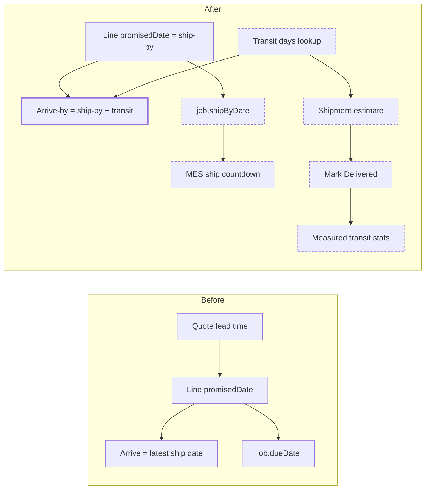
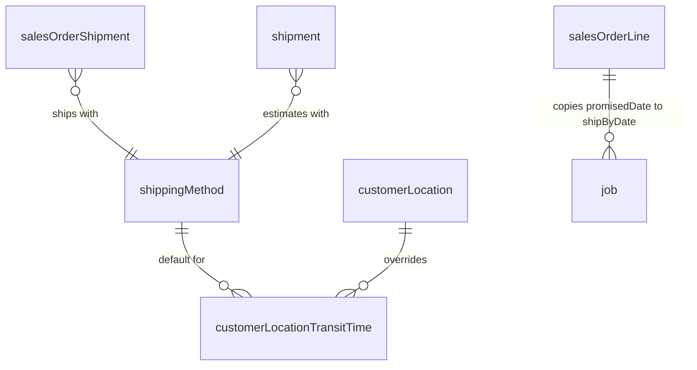

# Carrier transit time and ship-by dates

> Status: in-progress
> Author: naveenkash
> Date: 2026-11-17
> Research: `.ai/research/2026-11-17-carrier-transit-ship-by-dates.md`

## TLDR

Carbon promises a ship-by date on each sales order line, but it has no transit time. So the order's arrive-by date equals its latest ship-by date. The shop floor also cannot see how close a job is to its ship-by date. This spec adds:

1. Transit days, in business days, on each shipping method, with an override for one ship-to address and shipping method pair.
2. Date math between the header arrive-by date and the line ship-by dates.
3. A stored `job.shipByDate` that follows the line, and a ship countdown on 3 MES screens.
4. An estimated delivery date on each posted sales shipment, a **Mark Delivered** action, and measured transit statistics on each shipping method.

A carrier API integration (EasyPost, then UPS) is a later phase and is out of scope. Section 8 defines the 2 seams that the integration plugs into, so it changes no call site.

## Overview diagram



## Problem Statement

A customer asks for goods in 10 days. Production needs 3 days and the carrier needs 5 days. So the goods must ship by day 5. Carbon cannot show this today:

| Gap | Where | Effect |
|-----|-------|--------|
| No transit time | `shippingMethod` has only `name`, `carrier`, `carrierAccountId`, `trackingUrl` | Carbon cannot turn a ship-by date into an arrive-by date |
| Arrive-by date equals the ship-by date | Quote → order (`convertDocument` in `apps/erp/app/modules/shared/shared.service.ts`) sets `salesOrderShipment.receiptPromisedDate` to the latest line `promisedDate` | The arrive-by date is 5 days early in the example |
| No ship-by date on the job | `job.dueDate` is a planner field. It does not follow the line after the job is created | Operators cannot see the ship-by date |
| No countdown | MES cards show "Due {relative time}" from `dueDate` only (`apps/mes/app/components/Kanban/components/ItemCard.tsx`) | Operators cannot see how many days are left to ship |
| No actual delivery date | Posting a sales shipment records `shipment.postingDate` only | Nobody can check whether the transit days are correct |

The glossary already gives the two dates the right meaning (`docs/content/src/glossary/terms.ts`):

| Field | Glossary meaning |
|-------|------------------|
| `salesOrderLine.promisedDate` | "When this specific line is promised to ship" |
| `salesOrderShipment.receiptPromisedDate` | "When Carbon committed to having the goods arrive; combined with the shipping method's transit days, this drives Ship Date back-calc" |

The glossary describes the back-calculation, but no code does it yet.

## Proposed Solution

### Terms

| Term | Meaning | Column |
|------|---------|--------|
| ship-by date | The date a line must leave the plant | `salesOrderLine.promisedDate` (existing) |
| arrive-by date | The date the order must reach the customer | `salesOrderShipment.receiptPromisedDate` (existing) |
| transit days | Business days from the ship-by date to the arrive-by date | `shippingMethod.transitDays`, or the override |
| transit override | Transit days for one ship-to address and shipping method pair | `customerLocationTransitTime.transitDays` (new) |
| business day | Monday to Friday, minus the company's `holiday` rows | — |
| estimated delivery date | `shipment.postingDate` + transit days | `shipment.estimatedDeliveryDate` (new) |
| delivered date | The date the customer received the goods | `shipment.deliveredDate` (new) |
| ship countdown | Calendar days from the plant's today to `job.shipByDate` | — |

### 1. The business-day calendar

Carriers move parcels on weekdays. So transit days count Monday to Friday, minus each `holiday` row of the company. Plant shifts do not change this calendar, because a plant that works on Saturday does not make the carrier deliver on Saturday.

Add 3 pure functions to `packages/utils/src/date.ts`. Each one takes `YYYY-MM-DD` strings and a `Set<string>` of holiday dates.

| Function | Result |
|----------|--------|
| `addBusinessDays(date, days, holidays)` | Steps forward one business day at a time, `days` times. With `days` = 0, it returns `date` unchanged. |
| `subtractBusinessDays(date, days, holidays)` | Steps back one business day at a time, `days` times. With `days` = 0, it returns `date` unchanged. |
| `businessDaysBetween(start, end, holidays)` | The count of business days after `start`, up to and including `end`. |

The functions skip non-working days while they count, like Business Central and SAP. Examples with no holidays:

| Call | Result |
|------|--------|
| `addBusinessDays("2026-11-20", 3)` (a Friday) | `"2026-11-25"` (Wednesday) |
| `subtractBusinessDays("2026-11-23", 1)` (a Monday) | `"2026-11-20"` (Friday) |
| `addBusinessDays("2026-11-21", 1)` (a Saturday) | `"2026-11-23"` (Monday) |
| `businessDaysBetween("2026-11-20", "2026-11-25")` | `3` |

The functions use `@internationalized/date` (`parseDate`, `getDayOfWeek`). They never use JavaScript `Date` (`.claude/rules/date-handling.md`).

### 2. Transit days lookup

Add one building block to `apps/erp/app/modules/sales/sales.service.ts`:

```ts
type TransitLane = {
  companyId: string;
  shippingMethodId: string | null;
  customerLocationId: string | null; // the ship-to address
  locationId: string | null;         // the plant the goods leave from
  shipDate: string | null;           // YYYY-MM-DD
};
type TransitDays = {
  transitDays: number;
  source: "Ship-to override" | "Shipping method";
};
resolveTransitDays(db, lane: TransitLane) → Promise<TransitDays | null>
```

1. If `shippingMethodId` is null, return null.
2. If a `customerLocationTransitTime` row matches the ship-to address and the shipping method, return its `transitDays` with the source "Ship-to override".
3. If `shippingMethod.transitDays` is not null, return it with the source "Shipping method".
4. Else return null.

Null means "unknown". If the transit days are unknown, Carbon calculates no date and shows no warning. The ship-to address of an order comes from `resolveSalesOrderShipTo` (`packages/ee/src/rules/sales/server.ts`). For a drop shipment, it is the drop-ship location.

`resolveTransitDays` ignores `locationId` and `shipDate` in v1. Each caller passes them now, because a carrier API needs the origin ZIP code and the ship date (section 8).

Holidays come from `getHolidayDateSet` (`sales.service.ts`). It is the Kysely sibling of `getHolidayDates` (`production.service.ts`), because quote → order and shipment posting read holidays inside a Kysely transaction.

### 3. Date math on the sales order

| Event | Behavior |
|-------|----------|
| Quote → order | Arrive-by = the latest line ship-by date + transit days (business days). The lane uses `quoteShipment.shippingMethodId` and the new order's `customerLocationId`, because `quoteShipment` has no ship-to. If the transit days are unknown, arrive-by = the latest line ship-by date (today's behavior). `receiptRequestedDate` keeps its current fallback. |
| A user adds a line with no `promisedDate` | If the order has an arrive-by date and known transit days, Carbon sets `promisedDate` = arrive-by − transit days (`latestShipByDate`). |
| A user changes the arrive-by date, the shipping method or the ship-to address | Carbon calculates the new ship-by date for each line. If 1 or more lines have a different `promisedDate`, Carbon asks "Recalculate the ship date on N lines?". Carbon never changes a line without a yes. |
| A line's ship-by date + transit days falls after the arrive-by date | The line shows a "Late to arrive" warning with the estimated arrival date. |

Carriers deliver on business days. So `latestShipByDate` (`sales.utils.ts`) counts the transit days back from the last business day on or before the arrive-by date. An order due on a Saturday ships in time for Friday. With 0 transit days, the line ships on the arrive-by date.

The recalculation changes only lines whose `salesOrderLineType` is in `DELIVERY_CHECKED_LINE_TYPES` (`sales.utils.ts`) and whose `sentComplete` is false.

The delivery date check (`.ai/specs/2026-11-10-sales-order-delivery-date-check.md`) already checks `promisedDate` against lead time, stock and capacity. That check asks "can the line be ready by its ship-by date?". The "Late to arrive" warning asks "does the ship-by date leave enough transit time?". The two checks are separate. Each one keeps its own icon. These rules join them:

1. `createSalesOrderLine` sets the default `promisedDate` before it calls `deliveryDateForSave`. So the delivery date check checks the default date.
2. `recalculateSalesOrderShipByDates` runs the delivery date check on each line it changes, with `capacity: "defer"`.
3. The "Late to arrive" icon sits next to `DeliveryDateFlag` in `SalesOrderExplorer.tsx`.

The prompt works through one resource route, `x+/sales-order+/$orderId.ship-by-dates.tsx`:

1. The client saves the header field as it does today.
2. When the save succeeds, the client loads the route. The loader returns the lines whose new ship-by date differs.
3. If 1 or more lines differ, the client opens the confirm modal.
4. "Yes" posts to the route action. The action calls `recalculateSalesOrderShipByDates`.

### 4. `job.shipByDate`

`job.shipByDate` is a stored, read-only copy of the linked line's `promisedDate`. Two database triggers write it. No application code writes it.

The triggers are plain triggers in the migration, not event-system interceptors. An interceptor (`packages/database/src/event-system/handlers`) cannot change `NEW`, and the job trigger must. Both run as their owner, so a sales user who moves a line also moves the job's copy.

| Trigger | Event | Action |
|---------|-------|--------|
| `job_set_ship_by_date` | BEFORE INSERT, or UPDATE OF `salesOrderLineId` or `shipByDate`, on `job` | Sets `NEW.shipByDate` to the line's `promisedDate`. If `salesOrderLineId` is null, sets null. A direct write of `shipByDate` is reset. |
| `sales_order_line_sync_job_ship_by_date` | AFTER UPDATE OF `promisedDate` on `salesOrderLine` | Updates `job.shipByDate` on every job with that `salesOrderLineId` and `companyId`, where the value differs |

`job.dueDate` does not change. The scheduler, the priority order and the overdue flags keep using `dueDate`. A later change can move them to `shipByDate`.

The `job_salesOrderLineId_fkey` foreign key is `ON DELETE SET NULL`. So a deleted line sets `salesOrderLineId` to null, and the first trigger then clears `shipByDate`.

### 5. The ship countdown on MES

The ship countdown counts calendar days from the plant's today to `job.shipByDate`. The plant's today comes from the location's timezone, the same today the cards use for "Due" today.

| Days left | Label | Tone |
|-----------|-------|------|
| more than 1 | "Ships in N days" | neutral |
| 1 | "Ships tomorrow" | amber |
| 0 | "Ships today" | amber |
| less than 0 | "N days late" | red |
| `shipByDate` is null | no label | — |

If the job is Completed or Cancelled, Carbon shows no label. The label sits next to the existing "Due" text and does not replace it. Sort orders do not change.

Add one pure helper, `getShipCountdown(shipByDate, today)` → `{ days, tone }`, to `packages/utils/src/date.ts`. Each screen formats the label with Lingui.

| Screen | Route | Data source |
|--------|-------|-------------|
| Operation cards | `apps/mes/app/routes/x+/operations.tsx` | RPC `get_active_job_operations_by_location` |
| Jobs list | `apps/mes/app/routes/x+/jobs.tsx` | `getOpenJobs` (`apps/mes/app/services/operations.service.ts`) |
| Assigned view | `apps/mes/app/routes/x+/assigned.tsx` | RPC `get_assigned_job_operations` |
| Assigned list view | `apps/mes/app/components/OperationsList.tsx` | the same rows as the assigned view |

The 2 RPCs return `jobShipByDate` as a new column. `getOpenJobs` reads the `jobs` view. That view selects `j.*`, and Postgres expands `*` when it creates a view. So the migration drops and creates the `jobs` view again from its latest definition. Then `getOpenJobs` selects `shipByDate`.

The assigned view has no plant's today now: `ItemCard` falls back to the device time zone, and `OperationsList` uses JavaScript `Date`. The `assigned.tsx` loader returns the plant's today, as `operations.tsx` does. `OperationsList` takes that today as a prop.

### 6. Estimated and actual delivery (sales shipments)

1. When `postShipment` posts a shipment whose `sourceDocument` is `'Sales Order'`, it calls `resolveTransitDays`.
2. If the transit days are known, `postShipment` sets `estimatedDeliveryDate` = `addBusinessDays(postingDate, transitDays, holidays)`.
3. A Posted sales shipment shows a **Mark Delivered** button.
4. The button opens a modal with one date field, **Delivered on**. The default is the company's today.
5. The service function refuses a date in the future and a date before `postingDate`.
6. The service function saves `deliveredDate` and sets `deliveredSource` to `'Manual'`.
7. A user can change the date or clear it later. A clear sets both columns to null.

If a user voids the shipment, `estimatedDeliveryDate` and `deliveredDate` stay on the voided row, and the statistics skip that row.

The shipment header shows 2 new meta entries: "Arrives {date} (estimated)" before delivery, and "Delivered {date}" after it. The shipments list gets 2 columns: **Estimated Delivery** and **Delivered**. `getShipments` selects `*` from `shipment`, so the list needs no query change.

### 7. Measured transit statistics

The shipping method drawer shows one line for the last 90 days:

> Last 90 days: 42 shipments, average 3.4 business days. 88% by the estimate, 93% by the promised date. **Use 4 days**

| Number | Source |
|--------|--------|
| shipments | Posted, not voided, `sourceDocument` = `'Sales Order'`, this `shippingMethodId`, `deliveredDate` not null, `postingDate` in the last 90 days |
| average | The mean of `businessDaysBetween(postingDate, deliveredDate)`, to one decimal |
| by the estimate | The share of rows with `deliveredDate` ≤ `estimatedDeliveryDate`. This rate measures the carrier and the transit days. Rows with no `estimatedDeliveryDate` are skipped. |
| by the promised date | The share of rows with `deliveredDate` ≤ the order's `salesOrderShipment.receiptPromisedDate`. This rate is the on-time delivery (OTD) to the customer. Rows whose order has no arrive-by date are skipped. |

An early delivery counts as on time in both rates. The research found no agreed tolerance window, so v1 has none.

**Use N days** rounds the average up and saves it as `shippingMethod.transitDays`. Carbon never changes `transitDays` without this click. If fewer than 5 shipments match, the drawer shows "Not enough deliveries yet" and no button. The statistics cover the shipping method only. Overrides show no statistics in v1.

### 8. The seams for a carrier integration

A later integration (EasyPost first, then UPS) plugs into 2 functions. Every caller already goes through them, so the integration changes no call site.

| Seam | Today | What the integration adds |
|------|-------|---------------------------|
| `resolveTransitDays(db, lane)` in `sales.service.ts` | Override, then shipping method | One step between the override and the shipping method: ask the provider for the lane. The lane already holds the origin plant, the ship-to address, the shipping method and the ship date. The integration adds a value to the `source` union. |
| `recordShipmentDelivery(db, { companyId, shipmentId, deliveredDate, source, userId })` in `inventory.service.ts` | The **Mark Delivered** action calls it with `source: 'Manual'` | A tracking webhook calls it with `source: 'Carrier'`. It converts the UTC event time to the company's local date first. |

`recordShipmentDelivery` is the only writer of `deliveredDate` and `deliveredSource`. It refuses a shipment that is not Posted, or not from a sales order. It refuses a date in the future or before `postingDate`. A carrier event must not overwrite a Manual date, so the function refuses a `'Carrier'` write over a `'Manual'` row. The carrier rows in research section 8 show the delivered signal of each provider.

The integration will also need a carrier service code on the shipping method (for example `GROUND`). The integration spec adds that column. This spec does not.

### Design Decisions

| Decision | Choice | Rationale |
|----------|--------|-----------|
| Meaning of `salesOrderLine.promisedDate` | The ship-by date | User decision. It matches the glossary. |
| Arrive-by date | `salesOrderShipment.receiptPromisedDate` | Q1. The column exists and the glossary gives it this meaning. |
| Who sets the line ship-by date | A default on new lines, a confirm prompt on header changes, and a "Late to arrive" warning | Q2. Carbon never overwrites a date a user typed. |
| `job.dueDate` | No change | User decision. A later change can switch the scheduler to `shipByDate`. |
| `job.shipByDate` storage | A stored column with 2 triggers as the only writers | Q3. The MES RPCs can sort and filter it with no extra join. |
| Where transit days live | `shippingMethod.transitDays`, plus `customerLocationTransitTime` per ship-to address and shipping method | Q4. Transit depends on the destination (SAP routes, Epicor Ship To). |
| Shipping methods per order | One, on `salesOrderShipment` | User decision. It matches the current schema. |
| Day count | Business days: Monday to Friday, minus `holiday` rows | User decision. Carriers quote ground service in business days. BC, SAP and Epicor count working days. |
| Calendar for transit | One company calendar, not one per carrier or customer | Smallest useful model. BC's carrier and customer calendars can follow if users ask. |
| Handling time per location | Out of scope | The coworker's example needs make time + transit only. |
| Countdown screens | MES operation cards, MES jobs list, MES assigned view | Q5. Picking lists and ERP screens are out of scope for v1. |
| Countdown unit | Calendar days to the plant's today | Operators read "3 days" as calendar days. It matches the existing "Due" text. |
| Actual delivery | A manual **Mark Delivered** date; statistics per shipping method; no auto-tuning | Q6. It builds the history that the carrier integration extends. |
| Unknown transit days | Null, not 0 | 0 means same-day (will-call). Null means "not set", so Carbon calculates nothing. |
| Integration seams | `resolveTransitDays` takes the whole lane. `recordShipmentDelivery` is the only writer of the delivered date. | User request: adding the integration must be easy. The lane holds every input a carrier API needs (research section 6). |
| Source of the delivered date | `deliveredSource` enum: `'Manual'`, `'Carrier'` | SAP fills the POD date from VLPOD or an IDoc. A carrier date must not overwrite a date a user typed. |
| On-time rates | 2 rates: by the estimate (the carrier) and by the promised date (OTD) | Research: on-time shipping and OTD measure different things. A low OTD with a high estimate rate points at the transit days. |
| Holidays | `getHolidayDateSet` (Kysely) in `sales.service.ts` | `getHolidayDates` (`production.service.ts`) takes a Supabase client, and the callers run inside a Kysely transaction |
| Delivery date check | Separate from "Late to arrive"; the default ship-by date is set before the check runs | The check answers "ready by the ship-by date". The new warning answers "transit fits". |
| The plant's today on the assigned view | The loader returns it | The countdown must flip at the plant's midnight, not the device's |
| Multi-tenancy | `customerLocationTransitTime` has `companyId`, PK `("id", "companyId")` and `id('ctt')` | Heuristic 1 |
| Service shape | Building blocks take `db`. The new operations are `defineServiceFn` operations in `sales.server.ts` and `inventory.server.ts`. | Heuristic 2, `.claude/rules/module-files.md` |
| RLS | `customerLocationTransitTime: company("sales", { read: "sales_view" })` in `packages/database/src/authz/manifest.ts` | Heuristic 3. It copies `customerItemRentalRate`. |
| Permissions | Transit days on the shipping method: `update: inventory`. Transit overrides: `update: sales`, plus `create: sales` for a new row, and `delete: sales`. Mark Delivered: `update: inventory`. | Heuristic 4. The manifest rule `shippingMethod: company("inventory")`, the customer Shipping tab (`update: sales`) and shipment posting use these scopes today. |
| Forms | `ValidatedForm` + `validator(zodSchema)` + a route action | Heuristic 5 |
| Module layout | Code goes into the existing `sales` and `inventory` module files. No new module. | Heuristic 6 |
| Backward compatibility | Every new column is nullable. The API gains fields and loses none. Existing orders keep their dates. | Heuristic 7 |

## Data Model Changes

```sql
-- 1. Transit days on the shipping method
ALTER TABLE "shippingMethod"
  ADD COLUMN "transitDays" INTEGER,
  ADD CONSTRAINT "shippingMethod_transitDays_check"
    CHECK ("transitDays" IS NULL OR "transitDays" >= 0);

-- 2. Override for one ship-to address and shipping method pair
CREATE TABLE "customerLocationTransitTime" (
  "id" TEXT NOT NULL DEFAULT id('ctt'),
  "companyId" TEXT NOT NULL,
  "customerLocationId" TEXT NOT NULL,
  "shippingMethodId" TEXT NOT NULL,
  "transitDays" INTEGER NOT NULL CHECK ("transitDays" >= 0),
  "createdBy" TEXT NOT NULL REFERENCES "user"("id"),
  "createdAt" TIMESTAMP WITH TIME ZONE NOT NULL DEFAULT NOW(),
  "updatedBy" TEXT REFERENCES "user"("id"),
  "updatedAt" TIMESTAMP WITH TIME ZONE,
  CONSTRAINT "customerLocationTransitTime_pkey" PRIMARY KEY ("id", "companyId"),
  CONSTRAINT "customerLocationTransitTime_unique"
    UNIQUE ("customerLocationId", "shippingMethodId", "companyId"),
  CONSTRAINT "customerLocationTransitTime_companyId_fkey"
    FOREIGN KEY ("companyId") REFERENCES "company"("id") ON DELETE CASCADE ON UPDATE CASCADE,
  CONSTRAINT "customerLocationTransitTime_customerLocationId_fkey"
    FOREIGN KEY ("customerLocationId") REFERENCES "customerLocation"("id") ON DELETE CASCADE,
  CONSTRAINT "customerLocationTransitTime_shippingMethodId_fkey"
    FOREIGN KEY ("shippingMethodId") REFERENCES "shippingMethod"("id") ON DELETE CASCADE
);
ALTER TABLE "customerLocationTransitTime" ENABLE ROW LEVEL SECURITY;
-- Policies come from the authz manifest (.claude/rules/authz-manifest.md).

-- 3. Ship-by date on the job
ALTER TABLE "job" ADD COLUMN "shipByDate" DATE;
CREATE INDEX "job_shipByDate_idx" ON "job" ("companyId", "shipByDate");
-- Triggers job_set_ship_by_date and sales_order_line_sync_job_ship_by_date (section 4).
-- DROP VIEW "jobs" and CREATE it again from 20261006220401_fleet-bridge.sql, so j.* includes "shipByDate".
-- Backfill: UPDATE "job" SET "shipByDate" = sol."promisedDate"
--   FROM "salesOrderLine" sol WHERE sol."id" = "job"."salesOrderLineId";

-- 4. Delivery dates on the shipment
CREATE TYPE "shipmentDeliveredSource" AS ENUM ('Manual', 'Carrier');
ALTER TABLE "shipment"
  ADD COLUMN "estimatedDeliveryDate" DATE,
  ADD COLUMN "deliveredDate" DATE,
  ADD COLUMN "deliveredSource" "shipmentDeliveredSource",
  ADD CONSTRAINT "shipment_deliveredSource_check"
    CHECK (("deliveredDate" IS NULL) = ("deliveredSource" IS NULL)),
  ADD CONSTRAINT "shipment_deliveredDate_check"
    CHECK ("deliveredDate" IS NULL OR "postingDate" IS NULL OR "deliveredDate" >= "postingDate");
```



After the migration, run `pnpm run generate:types`. Then add the manifest rule and run `pnpm --filter @carbon/database authz migration customer-location-transit-time`. The views that select `shippingMethod.*`, `job.*` or `shipment.*` need a check. A view that lists its columns does not show the new columns until the migration recreates it.

## API / Service Changes

| Item | File | Kind |
|------|------|------|
| `addBusinessDays`, `subtractBusinessDays`, `businessDaysBetween`, `getShipCountdown` | `packages/utils/src/date.ts` | pure functions, with tests |
| `resolveTransitDays` | `apps/erp/app/modules/sales/sales.service.ts` | building block |
| `getHolidayDateSet(db, companyId, { from, to })`, `transitHolidayRange` | `apps/erp/app/modules/sales/sales.service.ts` | building blocks: the holidays a business-day count can reach |
| Quote → order arrive-by | `convertDocument` in `apps/erp/app/modules/shared/shared.service.ts` | change |
| `getSalesOrderShipByDates` (the new ship-by date per line, for the prompt) | `apps/erp/app/modules/sales/sales.server.ts` | new operation |
| `recalculateSalesOrderShipByDates` (the yes of the prompt) | `apps/erp/app/modules/sales/sales.server.ts` | new operation, one Kysely transaction |
| `x+/sales-order+/$orderId.ship-by-dates.tsx` | `apps/erp/app/routes/` | new resource route: the loader calls `getSalesOrderShipByDates`, the action calls `recalculateSalesOrderShipByDates` |
| Default `promisedDate` on a new line | `createSalesOrderLine` in `sales.server.ts` | change |
| `createCustomerLocationTransitTime`, `updateCustomerLocationTransitTime` (both run `saveCustomerLocationTransitTime`), `deleteCustomerLocationTransitTime`, `getCustomerLocationTransitTimes` | `apps/erp/app/modules/sales/sales.server.ts` | new operations |
| `transitDays` on the shipping method validator | `apps/erp/app/modules/inventory/inventory.models.ts:545-549` | change |
| `getShippingMethodTransitStats` | `apps/erp/app/modules/inventory/inventory.server.ts` | new operation |
| `estimatedDeliveryDate` at posting | `postShipment` in `apps/erp/app/modules/inventory/inventory.service.ts` | change |
| `recordShipmentDelivery` | `apps/erp/app/modules/inventory/inventory.service.ts` | building block, the only writer of `deliveredDate` (section 8) |
| `markShipmentDelivered` | `apps/erp/app/modules/inventory/inventory.server.ts` | new operation, calls `recordShipmentDelivery` with `'Manual'` |
| `x+/shipment+/$shipmentId.delivered.tsx` | `apps/erp/app/routes/` | new action route for the **Mark Delivered** modal |
| `jobShipByDate` column | RPCs `get_active_job_operations_by_location`, `get_assigned_job_operations` | migration. Copy each RPC from its latest definition (`.ai/lessons.md` line 491). |
| `shipByDate` select | `getOpenJobs` in `apps/mes/app/services/operations.service.ts` | change |

## Closest Sibling

| New part | Sibling | Files to copy |
|----------|---------|---------------|
| `transitDays` on the shipping method | The other shipping method fields | `apps/erp/app/routes/x+/inventory+/shipping-methods.$shippingMethodId.tsx`, the `ShippingMethodForm` it renders, and `shippingMethodValidator` |
| Transit overrides | Customer contacts: a child list on a customer tab with a new / edit / delete drawer | `apps/erp/app/routes/x+/customer+/$customerId.contacts*.tsx`. The list goes on the customer's Shipping tab (`$customerId.shipping.tsx`). |
| Ship countdown | The "Due" text and the late tone on MES cards | `apps/mes/app/components/Kanban/components/ItemCard.tsx:115-119,312-330` |
| **Mark Delivered** modal | The **Delivered on** date in the rental shipment post modal | `apps/erp/app/modules/inventory/ui/Shipments/ShipmentPostModal.tsx:301-307` |
| Arrive-by date on the order | The purchase order delivery dates | `purchaseOrderDelivery.receiptPromisedDate` (`apps/erp/app/modules/purchasing/purchasing.server.ts:1944-1981`) |

Deviation: the transit override list sits on the customer's Shipping tab and not on the customer location drawer. One list for all ship-to addresses of the customer is easier to scan than one list per drawer.

## UI Changes

| Screen | Archetype | Change |
|--------|-----------|--------|
| Shipping method drawer (ERP) | Form drawer | A **Transit Days** number field. Below it, the measured statistics line and the **Use N days** button. |
| Customer → Shipping tab (ERP) | Detail page card | A **Transit Times** card: a table of ship-to address, shipping method and transit days, with New / Edit / Delete through a drawer |
| Sales order → Shipping card and Properties (ERP) | Existing form | After a change to the arrive-by date, the shipping method or the ship-to address, the confirm modal "Recalculate the ship date on N lines?" |
| Sales order lines (ERP) | Existing table and form | The "Late to arrive" warning, with the estimated arrival date in a tooltip. The line form shows it for the saved date only, because the business-day math needs the company holidays. A new line in the explorer starts from `defaultShipBy`. |
| Posted sales shipment (ERP) | Document page | A **Mark Delivered** button and modal in `ShipmentHeader`. The header `meta` shows "Arrives {date} (estimated)" or "Delivered {date}". |
| Shipments list (ERP) | List page | The **Estimated Delivery** and **Delivered** columns in `ShipmentsTable` |
| MES operation cards, jobs list, assigned view (board and list) | Existing shop-floor screens | The ship countdown label (section 5) |

Add glossary terms for `shippingMethod.transitDays`, `customerLocationTransitTime.transitDays`, `shipment.estimatedDeliveryDate`, `shipment.deliveredDate` and `job.shipByDate` in `docs/content/src/glossary/terms.ts`. Wrap every new string in Lingui and fill the catalogs with `/translate`.

## Acceptance Criteria

- [ ] `addBusinessDays("2026-11-20", 3, ∅)` returns `"2026-11-25"`. With `"2026-11-23"` in the holiday set, it returns `"2026-11-26"`.
- [ ] `subtractBusinessDays("2026-11-23", 1, ∅)` returns `"2026-11-20"`.
- [ ] A user sets **Transit Days** = 5 on a shipping method and sees 5 after a reload. The form refuses -1.
- [ ] A customer ship-to address has an override of 2 days for that shipping method. An order to that address with that method uses 2. An order to another address uses 5.
- [ ] A quote with one line at lead time 3 and a 5-day shipping method converts to an order. The line ship-by date is today + 3 calendar days. The arrive-by date is that date + 5 business days.
- [ ] A shipping method with no transit days converts a quote with today's behavior: arrive-by = the latest line ship-by date.
- [ ] A user adds a line with no promised date to an order with an arrive-by date. The line's promised date is arrive-by − 5 business days.
- [ ] A user moves the arrive-by date 2 days later on an order with 3 open lines. Carbon asks "Recalculate the ship date on 3 lines?". "No" leaves the 3 lines unchanged. "Yes" moves each line.
- [ ] A fully shipped line keeps its date after a "Yes".
- [ ] A line whose ship-by date + transit days falls after the arrive-by date shows "Late to arrive".
- [ ] A job created from a line gets `shipByDate` = the line's `promisedDate`. A change to the line's date changes `job.shipByDate`. `job.dueDate` stays the same.
- [ ] A user deletes the line. The job's `shipByDate` becomes null.
- [ ] A job with no sales order line has `shipByDate` null and shows no ship countdown.
- [ ] A job has `shipByDate` = the plant's today + 3. Its card on the MES operations board shows "Ships in 3 days". A card with yesterday's date shows "1 day late" in red. A Completed job shows no label.
- [ ] The MES jobs list and the assigned view (board and list) show the same labels for the same jobs.
- [ ] A user adds a line with no promised date. The delivery date check runs on the default date.
- [ ] A company has no holidays. A user posts a sales shipment with a 5-day method on Friday 2026-11-20. `estimatedDeliveryDate` is Friday 2026-11-27.
- [ ] **Mark Delivered** refuses tomorrow's date and a date before the posting date. It saves today's date with `deliveredSource` = `'Manual'`.
- [ ] `recordShipmentDelivery` with `'Carrier'` on a row whose `deliveredSource` is `'Manual'` returns an error and changes nothing.
- [ ] A posted shipment shows "Arrives {date} (estimated)" in its header. After **Mark Delivered**, it shows "Delivered {date}".
- [ ] The shipments list shows the **Estimated Delivery** and **Delivered** columns.
- [ ] A shipping method has 5 or more delivered shipments in 90 days. Its drawer shows the count, the average and the 2 on-time rates. **Use N days** saves the rounded-up average.
- [ ] A shipment delivered 1 day before its estimate counts as on time.
- [ ] With 4 delivered shipments, the drawer shows "Not enough deliveries yet".
- [ ] A user of company A cannot read or write a `customerLocationTransitTime` row of company B.

## Risks

| Risk | Severity | Mitigation |
|------|----------|------------|
| A copied RPC drops a branch that a later migration added | High | Copy each RPC from its latest migration (`.ai/lessons.md` line 491). Compare the old and new bodies before you commit. |
| The `job` trigger slows bulk job creation | Low | The trigger reads one row by primary key. `convertSalesOrderLinesToJobs` inserts in one statement. |
| The `ON DELETE SET NULL` foreign key action does not fire the `UPDATE OF "salesOrderLineId"` trigger | Low | Tested on 2026-11-17 in a rolled-back transaction: a line delete clears `job.shipByDate`. |
| The recalculation prompt annoys users who type every date | Low | The prompt shows only when 1 or more lines would change. "No" changes nothing. |
| Company holidays differ from carrier holidays | Low | Most carriers close on the major national holidays. A company that needs exact carrier calendars waits for the carrier integration. |
| The statistics query reads many shipments | Low | It reads 90 days for one shipping method, and 3 date columns only. |
| The new `jobs` view drops a column that a later migration added | High | Copy the view from its latest migration (`20261006220401_fleet-bridge.sql`). Compare the column lists before and after. |
| An order is confirmed between the lock check and the recalculation write | Low | The lock check runs before the transaction. The window is one request long. |
| A recalculation proposes a ship-by date before today | Low | The delivery date check runs on every moved line and flags a date that cannot be met. |
| The demo datasets have no transit overrides and no delivered shipments | Low | The shipping method statistics read "Not enough deliveries yet" on a new demo company. Seed delivered shipments when a demo needs the statistics. |
| `job.shipByDate` and `job.dueDate` confuse planners | Med | The ERP job screens do not show `shipByDate` in v1. The MES label says "Ships", and the existing text says "Due". |

## Out of Scope

| Item | Why |
|------|-----|
| Carrier API integration (EasyPost, UPS) and tracking webhooks | Later phase |
| Handling time per location | Not needed for make time + transit |
| A shipping method per line | One method per order (user decision) |
| The scheduler, priority and overdue flags on `shipByDate` | `job.dueDate` stays (user decision) |
| The countdown on picking lists and ERP screens | Q5 |
| Statistics per transit override | Q6 |
| LTL freight lanes | Needs a lane table or SMC3 |
| A carrier service code on the shipping method | The integration spec adds it (section 8) |
| A carrier or customer calendar | One company calendar in v1 |

## Open Questions

> The user answered every question on 2026-11-17, before this spec existed.

- [x] What does `salesOrderLine.promisedDate` mean? — **Answer:** the date the line ships ("ships by").
- [x] Should `job.dueDate` become the ship-by date? — **Answer:** no. Keep `job.dueDate` and add a separate ship-by field. A later change can switch.
- [x] One shipping method per order or per line? — **Answer:** one per order for now.
- [x] Business days or calendar days for transit? — **Answer:** business days.
- [x] Q1: Which date is the arrive-by promise? — **Answer:** `salesOrderShipment.receiptPromisedDate`. Quote → order sets it to the latest line ship-by date + transit days.
- [x] Q2: Who sets the line ship-by date? — **Answer:** a default on new lines, a confirm prompt when the header changes, and a "Late to arrive" warning. Carbon never overwrites a typed date without a yes.
- [x] Q3: How does Carbon keep `job.shipByDate`? — **Answer:** a stored, read-only column. Triggers are its only writers. Planners keep editing `dueDate`.
- [x] Q4: Where do transit days live? — **Answer:** `shippingMethod.transitDays` as the default, and an override for one ship-to address and shipping method pair.
- [x] Q5: Which screens show the ship countdown? — **Answer:** MES operation cards, MES jobs list and MES assigned view only.
- [x] Q6: How does Carbon learn the actual delivery? — **Answer:** an estimate at posting, a manual **Mark Delivered** date, and statistics on the shipping method with a **Use N days** button. No auto-tuning.
- [x] Q6b: Statistics per override too? — **Answer:** no. Per shipping method only in v1.
- [x] Build all of it in one PR, with no carrier integration, and make the integration easy to add? — **Answer:** yes (user, 2026-11-17).
- [x] Which source does the delivered date record? — **Autonomous:** `deliveredSource` `'Manual'` or `'Carrier'`. A carrier date never overwrites a Manual date. Research section 5 (SAP POD) and section 8 (tracking events).
- [x] Which on-time rates show on the shipping method? — **Autonomous:** 2 rates, by the estimate and by the promised date. Early counts as on time. Research section 5 (OTD vs on-time shipping).
- [x] Do the shipment header and the shipments list show the delivery dates? — **Autonomous:** yes. Without them, a user cannot see the estimate the statistics use.
- [x] Does the countdown also go on the assigned list view and picking lists? — **Autonomous:** the assigned list view yes, because it shows the same rows as the assigned board (Q5). Picking lists no, per Q5.

## Changelog

- 2026-11-17: Created. Phases 1 and 3 of the carrier transit design. Phase 2, the carrier integration, comes later.
- 2026-11-17: Added the competitor and delivery research and the 2 integration seams (section 8). Added `deliveredSource`, the 2 on-time rates, and the delivery dates on the shipment header and list. Joined the delivery date check, and gave the assigned view the plant's today. Open Questions records 4 autonomous decisions.
- 2026-11-17: Built. Deviations from the plan: holidays through a Kysely `getHolidayDateSet`; plain triggers, not interceptors; `job_set_ship_by_date` also resets a direct write of `shipByDate`; the override upsert checks `create: sales` inside the function; the line form shows "Late to arrive" for the saved date only; a new line in the explorer starts from `defaultShipBy`; the demo shipping methods get transit days from their names.
- 2026-11-17: Self-review and browser test fixes: `latestShipByDate` for a weekend or holiday arrive-by; the backfill sets `app.sync_in_progress`; Mark Delivered validates the date and reports a missing shipment as not found; Use N days remounts the shipping method form; the new line route starts from `defaultShipBy`. Browser verification passed for every flow (playbook `.ai/playbooks/carrier-transit-ship-by-dates.md`).
- 2026-11-17: Code review and edge-case pass: the prompt opens only when the plan shows the saved arrive-by date, shipping method and ship-to; the recalculation locks the order inside its transaction; the override has create and update operations (`saveCustomerLocationTransitTime`), and an update refuses another customer's override; one query reads a lane's transit days and `arrivalForLane` turns a lane into an arrival; a new line's default date follows its type on every path; the MES views show the countdown only on the plant's day. The database tests that fail here fail on `main` too (table ownership in the shared dev database).
