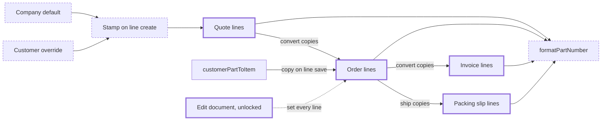

# Part numbers on customer and supplier documents

> Status: in progress. Every question is resolved. Part II (purchasing) is built first.
> Author: Raul Soonawala, with Claude
> Date: 2026-11-19
> Issues: ENG-102 (Part I), ENG-140 (Part II)
> Branches: `eng-140-supplier-part-number-display` (shared pieces and Part II, lands first), `eng-102-customer-part-number-display` (Part I, stacked on it)
> Priority: Part II first, or both built, reviewed and tested together (user, 2026-11-19)
> Research: `.ai/research/customer-part-number-display.md`

## TLDR

A company chooses which part numbers its documents print: our part number, the other party's part number, or both in either order.
Each document line stores the choice, because the line is where the part number prints.
A new line takes its value from the customer's or supplier's override, else from the company default.
The user changes the choice of one line, or of every line of a document at once, while the document is not locked.
Lines that exist before the change keep a null value and print exactly as they do today.

Part I covers the documents a customer receives (ENG-102). Part II covers the purchase order and replaces the fixed rule of PR #2290 (ENG-140). Part II has the higher priority.

## Overview diagram

The diagram shows Part I. Part II follows the same flow with the supplier, `supplierPart` and the purchase order line.



## Problem Statement

A customer or a supplier often has its own number for one of our items.
Carbon stores the customer's number in `customerPartToItem` and the supplier's number in `supplierPart`.
Each document decides in code which numbers it prints, and the documents disagree.

| Surface | Prints today |
|---|---|
| Quote PDF | Both: `P000123.B (C-100 Rev 3)` |
| Shared quote page | Our part number only |
| Sales order PDF and email | Both, and the customer part number a second time in the details line |
| Sales invoice PDF and email | Our part number only |
| Packing slip PDF | Our part number only |
| Purchase order PDF and email | The supplier part number only, else our part number (PR #2290, merged 2026-11-17) |

The disagreement causes 5 problems:

1. A company cannot choose. One customer wants its own number on every document; another wants ours only.
2. The sales order prints the customer part number twice.
3. The quote prints `(C-100 )` with a space when the customer part number has no revision.
4. The sales order reads the customer part number live from `customerPartToItem`. An edit to the cross-reference changes the PDF of every old order.
5. Since PR #2290, a purchase order line with a supplier part number prints neither our part number nor its revision.

Example: a precision shop buys 2 kinds of parts from one supplier. A catalog fastener is best known by the supplier's number. A bracket made to the shop's drawing needs the shop's number and revision. One choice for the whole purchase order cannot serve both lines.

## Proposed Solution

### Shared design (Part I and Part II)

- The display choice: which part numbers one line prints. It is one of 4 values of the enum `partNumberDisplay`.

| Value | Prints | Example |
|---|---|---|
| `Ours First` | our part number, then theirs in brackets | `P000123.B (C-100 Rev 3)` |
| `Theirs First` | their part number, then ours in brackets | `C-100 Rev 3 (P000123.B)` |
| `Theirs Only` | their part number | `C-100 Rev 3` |
| `Ours Only` | our part number | `P000123.B` |

- "Theirs" is the party the document goes to: the customer in Part I, the supplier in Part II. The enum is neutral, so both parts share it.
- Our part number is the item's `readableIdWithRevision`. Their part number is the number and, when present, ` Rev {revision}`.
- A line with no part number of theirs prints our part number, whatever the choice.
- Each document line stores its own display choice. The company default and the party override are only the values a new line starts with.
- Stamp: a trigger writes the display choice onto a new line. It reads the party through the line's document: the party's override, else the company default. The stamp covers every insert path: forms, conversions, the API, MCP, imports and jobs.
- A conversion copies each source line's display choice, so an order line prints like its quote line. A legacy source line copies a null, so the stamp gives the new line the current starting value.
- Legacy line: a line whose display choice is null. Every line that exists when the migration runs is a legacy line. A legacy line prints exactly as its surface prints today. No migration rewrites a line.
- The "Edit document" modal sets the display choice of every line of one document at once. A line form that allows edits sets one line. Both follow the document's lock.
- One pure formatter, `formatPartNumber`, prints the part number for every surface, the in-app shared pages included.
- The template keeps separate merge fields for our part number and for theirs. These fields hold their value whatever the display choice, so a custom template never loses a number (the defect CodeRabbit found in PR #2290).

### Part I: sales documents

Part I covers 7 surfaces:

- the quote PDF and the shared quote page
- the sales order PDF and email
- the sales invoice PDF and email
- the packing slip PDF

1. The company default is `companySettings.customerPartNumberDisplay`, set in Settings > Sales > Documents. Its default is `Ours First`.
2. The customer override is the nullable `customer.partNumberDisplay`, set on the customer's Details form. Null means the company default applies.
3. `quoteLine`, `salesOrderLine`, `salesInvoiceLine` and `shipmentLine` each get a nullable `partNumberDisplay`.
4. A sales order line keeps its own copy of the customer part number and revision. The line copy stops a later edit of `customerPartToItem` from changing an order.
5. Sales invoices and packing slips read the customer part number from the sales order line.
6. The sales line forms get no new field (Q6). A user changes a sales document's lines in the Edit document modal.

A legacy line prints as today:

| Surface | A null display choice prints as |
|---|---|
| Quote PDF | `Ours First` |
| Shared quote page | `Ours Only` |
| Sales order PDF and email | `Ours First`, with the customer part number once |
| Sales invoice PDF and email | `Ours Only` |
| Packing slip PDF | `Ours Only` |

The sales order fix (problem 2) and the quote fix (problem 3) change a legacy line's print. Both are defects, so both fixes apply to legacy lines too.

A line copy works as follows:

1. If a line has its own copy, the documents print the copy.
2. If a line has no copy, the documents print the live `customerPartToItem` value. Every line that exists at the migration has no copy, so it prints as today.
3. A new line gets a copy at its first save, if the cross-reference has a number for the order's customer and the line's item.
4. A new line whose item had no customer part number at creation has no copy. It picks up a number that the user adds to the cross-reference later, as every line does today.

### Design Decisions

| Decision | Choice | Rationale |
|---|---|---|
| Where the display choice lives | A nullable column on each document line table (`quoteLine`, `salesOrderLine`, `salesInvoiceLine`, `shipmentLine`) | Resolved with the user (Q10). The line is where the part number prints, and the right choice can differ by item. The user's rule from Q7 still holds: a change of the options never changes an existing line. |
| Document level | No document column. The Edit document modal writes every line of the document. | One source of truth per line. A document column would be a third value to keep in step. |
| Values | `Ours First` (default), `Theirs First`, `Theirs Only`, `Ours Only` | Resolved with the user (Q2). Epicor's `CustPartOpts` has the same 4 choices. Neutral names let Part II reuse the enum. |
| Levels | Company default plus a nullable customer override, as starting values for a new line | Resolved with the user (Q3, Q10). Precedent: `customer.defaultCc` over `companySettings.defaultCustomerCc`. |
| Stamp | A plain BEFORE INSERT trigger on each line table fills a null `partNumberDisplay` from the document's party | The line tables have insert paths in more than 6 files. A trigger covers all of them. Precedent: `rentalAgreement_customer_change_clears_contacts` (`20261104063711`). Event-system interceptors return void and cannot change the row, so they do not fit. |
| Trigger security | `SECURITY DEFINER`, `SET search_path = public`, every read scoped by `NEW."companyId"` | A caller who can write the line must get the stamp even when RLS hides the customer or `companySettings` row (a key with narrow scopes). A trigger function is not callable as an RPC. Same choice as the rental trigger. |
| Restore and demo data | Every trigger returns at once when `app.backup_load` is set. Company restore and import set it. A demo dataset apply and an accounting sync do not, so their lines are stamped. | A company restore must keep a legacy line's null. Restore and import load in replica mode when the connection allows it, else with triggers on (`company-backup.ts`). The dataset tiers insert parties before lines, so the triggers give seeded lines the values they give any line. |
| Conversions | `convertDocument` copies each line's `partNumberDisplay`: quote line to order line, order line to invoice line (also through `shipmentToSalesInvoice`), order line to shipment line. The quote revision copy (`quoteToQuote`) already copies every line column. | A converted line prints like its source. The trigger only fills a null, so a copied value wins. |
| Customer change | An AFTER UPDATE OF `customerId` trigger on `quote`, `salesOrder`, `salesInvoice` and `shipment` stamps the new customer's choice onto every line that has a value | The stamps came from the old customer. A legacy line stays legacy. Precedent: contracts and rental agreements reset customer defaults on a customer change. |
| New line on a legacy document | The new line gets a stamp, like any new line | The rule is per line. A user who wants one format on the whole document sets it in the Edit document modal. |
| Line copy | `salesOrderLine.customerPartId` and `salesOrderLine.customerPartRevision`, the names `quoteLine` and `salesRfqLine` use | Resolved with the user (Q5). 5 of the 6 surveyed products copy the customer number onto the order line. |
| Line copy writer | A BEFORE INSERT OR UPDATE OF `itemId` trigger on `salesOrderLine` copies the pair from `customerPartToItem`. The `salesOrder` customer change trigger copies it again for every line. | Resolved with the user (Q6): no form field. A trigger covers every line insert path. A customer change must not leave another customer's numbers on the order. |
| Existing lines | No backfill. A line with no copy uses the live cross-reference. | Resolved with the user (Q7). The purchase order uses the same fallback (`supplierPartIdFromSupplier`). |
| `salesOrderLines` view | `sl.*` carries the line copy. The live join moves to `customerPartIdFromCustomer` and `customerPartRevisionFromCustomer`. Code reads the copy, else the live value. | `sl.*` already outputs `customerPartId`, so the live value needs another name. Precedent: `purchaseOrderLines.supplierPartIdFromSupplier`. The user accepted the change to this public read (Q9). |
| Invoice and packing slip source | `salesInvoiceLines` and `shipmentLines` return the order line's pair when it has one, else the cross-reference pair | Resolved with the user (Q5). The pair stays together, so a copy's number never prints with the cross-reference's revision. |
| Document editor | A "Part Numbers" select in the "Edit document" modal, saved by `saveDocumentEdit` in the same transaction as the notes. It writes every line of the document. | The modal already changes how one document prints. `saveDocumentEditRow` already writes a record column (the notes) under the record's lock. |
| Mixed lines | When the lines of a document hold different values, the select shows "Mixed". A pick sets every line. | The user sees that the lines differ before one pick overwrites them. |
| Locked documents | The choice follows the modal's lock: a quote leaves Draft, an order is confirmed, an invoice leaves Draft, a shipment is Posted or Voided | Resolved with the user (Q8). |
| Value edits | A per-line value edit of `line.description` still wins over the display choice | The value edit is free text the user typed for one line of one document. |
| Merge fields | `line.description` (quote, order, invoice) and `line.item` (packing slip) print per the line's display choice. New fields on all 4: `line.itemId` (our part number), `line.customerPartId`, `line.customerPartRevision`. | A template author can place each number. The fields keep their value whatever the choice, which avoids the PR #2290 defect. Research finding 5: NetSuite and Business Central give the layout separate fields. |
| Shared formatter | `formatPartNumber` and `resolvePartNumberDisplay` in `packages/documents/src/utils/part-number.ts`, exported from `@carbon/documents/utils` | The shared quote page runs in the browser and must import from the client-safe entry. One formatter keeps the 7 surfaces and Part II in step. |
| Heuristic 1: multi-tenancy | No new table. The new columns sit on tables that already have `companyId` and a composite key. | |
| Heuristic 2: service shape | No new building block. `updateSalesSettings`, the customer upsert and `saveDocumentEdit` take the new field. | |
| Heuristic 3: RLS | No new table, so no new policy. The columns follow their table's policies. | |
| Heuristic 4: permissions | Settings card: `update: settings`, as the card's siblings. Customer form: `update: sales`. Edit document: the existing keyed permission `{ by: "documentType" }`. | |
| Heuristic 5: forms | The settings card joins the `salesSettingsForm` discriminated union. The customer field joins `customerValidator`. The modal posts the value with the edit. | |
| Heuristic 6: module layout | No new module. The formatter lives in `@carbon/documents`; no barrel. | |
| Heuristic 7: compatibility | Two changes: `salesOrderLines.customerPartId` becomes the line copy (Q9), and new invoices and packing slips print the customer part number by default. A changelog entry names both. | |

## Data Model Changes

Part I needs 1 migration for the columns, triggers and views. It changes production-critical tables (`quoteLine`, `salesOrderLine`, `salesInvoiceLine`, `shipmentLine`, `customer`, `companySettings`). Every new column is nullable or has a default, and no migration rewrites a line. The document tables (`quote`, `salesOrder`, `salesInvoice`, `shipment`) get no column.

```sql
-- The shared migration on eng-140 creates the enum:
-- CREATE TYPE "partNumberDisplay" AS ENUM
--   ('Ours First', 'Theirs First', 'Theirs Only', 'Ours Only');

-- The company default for customer documents. A metadata-only change.
ALTER TABLE "companySettings"
  ADD COLUMN "customerPartNumberDisplay" "partNumberDisplay" NOT NULL DEFAULT 'Ours First';

-- Null: the company default applies to a new line.
ALTER TABLE "customer" ADD COLUMN "partNumberDisplay" "partNumberDisplay";

-- Null: a legacy line, which prints as its surface printed before this change.
ALTER TABLE "quoteLine" ADD COLUMN "partNumberDisplay" "partNumberDisplay";
ALTER TABLE "salesOrderLine" ADD COLUMN "partNumberDisplay" "partNumberDisplay";
ALTER TABLE "salesInvoiceLine" ADD COLUMN "partNumberDisplay" "partNumberDisplay";
ALTER TABLE "shipmentLine" ADD COLUMN "partNumberDisplay" "partNumberDisplay";

-- The line copy. Null on every line that exists at the migration.
ALTER TABLE "salesOrderLine"
  ADD COLUMN "customerPartId" TEXT,
  ADD COLUMN "customerPartRevision" TEXT;

-- The stamp on one line table. The 3 other line tables get the same function,
-- each reading the customer through its own document column.
CREATE OR REPLACE FUNCTION stamp_sales_order_line_part_number_display()
RETURNS TRIGGER LANGUAGE plpgsql SECURITY DEFINER SET search_path = public AS $$
BEGIN
  IF current_setting('app.backup_load', true) = 'on'
    OR NEW."partNumberDisplay" IS NOT NULL THEN
    RETURN NEW;
  END IF;
  NEW."partNumberDisplay" := COALESCE(
    (SELECT c."partNumberDisplay"
      FROM "salesOrder" so
      JOIN "customer" c ON c."id" = so."customerId" AND c."companyId" = so."companyId"
      WHERE so."id" = NEW."salesOrderId" AND so."companyId" = NEW."companyId"),
    (SELECT s."customerPartNumberDisplay" FROM "companySettings" s
      WHERE s."id" = NEW."companyId")
  );
  RETURN NEW;
END;
$$;
```

Each trigger function reads the customer and the company default itself, so the migration adds no RPC. The `public-definer-function-authorizes-caller` invariant skips functions that return `trigger`.

The migration also adds:

- The stamp trigger on `quoteLine` (through `quoteId`), `salesInvoiceLine` (through `invoiceId`) and `shipmentLine` (through `shipmentId`). A shipment with no customer gives a null, which prints as the legacy packing slip.
- A customer change trigger: AFTER UPDATE OF `customerId` on `quote`, `salesOrder`, `salesInvoice` and `shipment`. It stamps the new customer's value onto every line that has a value, in one UPDATE per document.
- `copy_sales_order_line_customer_part()`: BEFORE INSERT OR UPDATE OF `itemId` on `salesOrderLine`. On INSERT with no copy, and on every item change, it writes the pair from `customerPartToItem` for the order's customer. The pair is null when the cross-reference has no row.
- On a `salesOrder` customer change, the same trigger also writes the new customer's pair onto every line.
- Every trigger UPDATE stamps `updatedBy` (`COALESCE` of the document's `updatedBy` and `createdBy`) and `updatedAt`, per the lesson on trigger audit columns.
- `salesOrderLines`: DROP and CREATE, because `sl.*` grows. Copy the body from `20261117063412_delivery-date-check.sql`. `cp."customerPartId"` becomes `"customerPartIdFromCustomer"`, and `cp."customerPartRevision"` becomes `"customerPartRevisionFromCustomer"`.
- `salesInvoiceLines`: `customerPartId` and a new `customerPartRevision` come from the order line's copy when it has one, else from `customerPartToItem`.
- `shipmentLines`: new `customerPartId` and `customerPartRevision`. For a `Sales Order` shipment they come from the order line (`lineId`). Otherwise they come from `customerPartToItem` for the shipment's customer.
- `quoteLines`: DROP and CREATE, because `ql.*` grows. No function or view depends on it.
- `salesInvoiceLines` and `shipmentLines`: DROP and CREATE, for the same reason.
- `customers`: append `partNumberDisplay` with `CREATE OR REPLACE`.

Backups: the new columns are not row ids, so `ID_REF_COLUMNS` and `TABLE_RENAMES` need no entry. A backup taken before the change restores with null values, which print as legacy lines. `company-restore.ts` and `company-import.ts` (`packages/jobs`) set `app.backup_load = 'on'` for the load, so the triggers skip it when replica mode is not available.

Demo data: the triggers stamp the seeded lines and copy the numbers as they do for any line. One customer in each dataset that has customers gets an override. The `COVERAGE` table in `datasets/validate.ts` gets an entry for it. The `motor-line` walkthrough has no customers, so it has no override.

## API / Service Changes

`@carbon/documents`:

1. Add `utils/part-number.ts`. It exports `PART_NUMBER_DISPLAYS`, `resolvePartNumberDisplay(surface, stored)`, `formatPartNumber({ ours, theirs, theirsRevision }, display)` and `lineCustomerPart(line)` (the copy, else the `FromCustomer` value). `utils/index.ts` re-exports them.
2. `utils/quote.ts`, `utils/sales-order.ts` and `utils/sales-invoice.ts`: `getLineDescription` resolves the line's own display choice and calls `formatPartNumber`. The sales order `getLineDescriptionDetails` stops appending the customer part number.
3. `template/mergeFields.ts`: add `LINE.customerPartId` ("Line Customer Part ID") and `LINE.customerPartRevision` ("Line Customer Part Revision") as `value` fields. The labels follow "Line Supplier Part ID". Add them and `LINE.itemId` to the quote, sales order, sales invoice and packing slip line fields. Add each name to `MERGE_FIELD_NAMES`.
4. Line var builders: `buildQuoteLineVars`, `buildSalesOrderLineVars`, the sales invoice builder in `pdf/blocks/vars.ts` and `buildPackingSlipLineVars` fill the new fields. They print `line.description` or `line.item` per the line's display choice.
5. `SalesOrderEmail` and `SalesInvoiceEmail` need no change. With no draft, `getLineDescription` reads the line's stored value.
6. Samples: give one line a customer part number in `quote.samples.ts`, `salesOrder.samples.ts`, `packingSlip.samples.ts` and `SAMPLE_SALES_INVOICE` (`samples.ts`). Update the `preview-documents.test.ts` and `previewClick.pdf.test.ts` snapshots.

ERP:

1. `settings.updateSalesSettings`: a new intent, `customerPartNumberDisplay`, writes `companySettings.customerPartNumberDisplay`.
2. `customerValidator`: optional `partNumberDisplay`. An empty value saves null. The customer create and update operations pass it through, so the MCP tools take it.
3. `settings.saveDocumentEdit`: optional `partNumberDisplay` for the types `quote`, `salesOrder`, `salesInvoice` and `packingSlip`. `saveDocumentEditRow` writes it to every line of the record, in the same transaction as the notes. It refuses the write on a locked record. `DOCUMENT_EDIT_RECORDS` names each type's line table and document column.
4. `DocumentEdit` gets an optional `partNumberDisplay`. The preview and download routes print every line with it, as they print `notes`.
5. `getDocumentEditor` returns the lines' common value, or "mixed" when they differ, or null when every line is legacy.
6. `convertDocument` (`shared.service.ts`): `quoteToSalesOrder` copies each line's `partNumberDisplay`, `customerPartId` and `customerPartRevision`. `salesOrderToSalesInvoice`, `shipmentToSalesInvoice` and `shipmentFromSalesOrder` copy each line's `partNumberDisplay` from the order line.
7. `getMethod` `quoteToQuote` (`production.service.ts`) needs no change. It spreads each `quoteLine` row, so the revision gets the column.
8. 4 renderers pass the draft's display choice, when the modal sends one, to the drivers. The quote and sales order renderers are in `sales.pdf.tsx`. The invoice and packing slip loaders are `sales-invoice-document.server.tsx` and `packing-slip-document.server.tsx` in `packages/lib`. The print job and `automate-invoice.ts` call the same loaders.
9. `share+/quote.$id.tsx` prints each line heading with `formatPartNumber` and `resolvePartNumberDisplay("sharedQuote", line.partNumberDisplay)`.

Docs and changelog: update the customer part number page in `docs/content` and add a changelog entry at ship time.

## Closest Sibling

The purchase order and its supplier part number are the sibling.

| Piece | Sibling | Part I copy |
|---|---|---|
| Line copy | `purchaseOrderLine.supplierPartId` | `salesOrderLine.customerPartId`, `customerPartRevision` |
| View fallback | `purchaseOrderLines.supplierPartIdFromSupplier` | `salesOrderLines.customerPartIdFromCustomer` |
| Line helper | `getLineSupplierPartId` (`utils/purchase-order.ts`) | `lineCustomerPart` (`utils/part-number.ts`) |
| Merge field | `LINE.supplierPartId` | `LINE.customerPartId`, `LINE.customerPartRevision` |

Deviations, each a Design Decision above:

- The purchase order line form lets the user edit the supplier part number. The sales order line form has no field (Q6).
- A database trigger writes the line copy. The purchase order form fills it in the browser.
- The display choice is new on both sides. Part II adds it to the purchase order line.

The settings card copies the Delivery Date Control card in `x+/settings+/sales.tsx`: one select, its own intent. The customer field copies the Currency field on `CustomerForm.tsx`.

## UI Changes

- Settings > Sales > Documents (settings page): a new card, "Part Numbers on Documents", with one select of the 4 values. Labels: "Our part number, then the customer's", "The customer's part number, then ours", "The customer's part number only", "Our part number only".
- Customer Details form (record form): a "Part Numbers on Documents" select with the placeholder "Company default". The user clears it to save null.
- Edit document modal (modal), on a quote, sales order, sales invoice or packing slip: a "Part Numbers" select in the Line Items panel. A pick sets every line. The preview prints the draft choice. A locked record shows the select read-only. The select shows "Mixed" when the lines differ, and "Not set: prints as before" when every line is legacy.
- Shared quote page (public page): each line heading prints per its line's display choice.
- The sales line forms do not change.

Every new label goes through Lingui, and `/translate` fills the catalogs. Check both themes.

## Acceptance Criteria

Fixture: item P000123 Rev B; customer A with cross-reference C-100 Rev 3; customer B with cross-reference C-200 and no revision.

- [ ] With no default or override changed, a new quote PDF for customer A prints `P000123.B (C-100 Rev 3)`.
- [ ] A new quote PDF for customer B prints `P000123.B (C-200)`, with no space before the bracket.
- [ ] A new sales order PDF and email for customer A print `C-100 Rev 3` once per line.
- [ ] The user sets the company default to "The customer's part number only". A new sales order for customer A prints `C-100 Rev 3`. A line for an item with no customer part number prints its own part number.
- [ ] The user sets customer B's override to "Our part number only". A new invoice for customer B prints `P000123.B`, while the company default stays "The customer's part number only".
- [ ] A sales order that exists before the migration prints the same text as before, except that the customer part number prints once. A change of the company default leaves it unchanged.
- [ ] An invoice and a packing slip that exist before the migration print no customer part number.
- [ ] The user creates an order line, then edits the cross-reference to C-101. The order's PDF still prints C-100.
- [ ] The user converts a quote to a sales order. Each order line has its quote line's display choice, customer part number and revision.
- [ ] The user invoices and ships that order. The invoice PDF, the invoice email and the packing slip use each order line's display choice and customer part number.
- [ ] On a Draft sales order, the user picks a choice in Edit document. The preview changes before the save. After the save, every line holds the choice, and the PDF and the email use it.
- [ ] On a Draft sales order whose lines hold 2 different values, the Edit document select shows "Mixed".
- [ ] On a confirmed sales order, the select is read-only, and a direct save of a new choice returns "This document is locked."
- [ ] The user changes the customer of a Draft sales order from A to B. Each line takes customer B's choice and customer B's part number, or none.
- [ ] The shared link of a new quote for customer A prints `P000123.B (C-100 Rev 3)`. The shared link of an old quote prints `P000123.B`.
- [ ] A template text `{line.itemId} / {line.customerPartId} {line.customerPartRevision}` saves on all 4 documents and prints `P000123.B / C-100 3`, whatever the display choice.
- [ ] A company restore of a backup taken before the migration leaves every restored line's choice null.
- [ ] `pnpm db:check:datasets` passes, and each dataset that has customers has a customer with an override.

## Part II: Purchasing documents

Part II applies the shared design to the purchase order PDF and email (P1). It replaces the fixed rule of PR #2290. It has the higher priority. The branch `eng-140-supplier-part-number-display` carries the shared pieces and Part II, and lands first.

What exists today:

- `purchaseOrderLine.supplierPartId` is an editable line copy. The `purchaseOrderLines` view falls back to `supplierPartIdFromSupplier`.
- Only the line form fills the line copy. `supplierQuoteToPurchaseOrder` and `purchaseOrderFromJob` (`shared.service.ts`) leave it null, so those lines read the live `supplierPart`.
- `supplierPart` has no revision column. `supplierQuoteLine` has `supplierPartId` and `supplierPartRevision`. `purchasingRfqLine` and `purchaseReturnOrderLine` have neither.
- After PR #2290, the purchase order PDF and email print `Theirs Only`, with our part number as the fallback. Before it, the PDF printed our part number as the line title and the supplier part number in a "Supplier Part ID:" row. The email printed `P000123.B (SW-1045-50R)`.

PR #2290 left 3 defects. Part II fixes them:

1. A purchase order line with a supplier part number prints neither our part number nor its revision. `supplierPart` has no revision, so the revision reaches no part of the PO.
2. `{line.supplierPartId}` is blank on item lines. A custom template that prints it loses the number. CodeRabbit reported this, and the PR merged without a fix.
3. The purchase order line fields have no `line.itemId`, so no template can print our part number.

Direction: the user asked that every Part I decision hold for Part II (2026-11-19). The table maps each one.

| Part I decision | Part II |
|---|---|
| 4 values, default `Ours First` | Same 4 values. Deviation: `companySettings.supplierPartNumberDisplay` defaults to `Theirs First` (P3). |
| Company default plus a nullable party override | Settings > Purchasing, and `supplier.partNumberDisplay` on the supplier form. |
| Each line stores its choice; a trigger stamps each new line; conversions copy each line's value | `purchaseOrderLine.partNumberDisplay`, stamped from the supplier override, else the company default (Q10). |
| A legacy line prints as before; defect fixes apply to it | A legacy purchase order line prints as before PR #2290 (P2). |
| The Edit document modal sets every line; the lock applies | Same. `isPurchaseOrderLocked` decides the lock. |
| The sales line forms get no field | Deviation: the purchase order line form gets a "Part Numbers" select, because the user decides there (Q10). The form already lets the user edit the line. |
| The line keeps its own copy, written by a trigger on every insert path | Part II adds the same trigger for `purchaseOrderLine.supplierPartId`. The supplier quote conversion copies the quote line's number. |
| The user cannot edit the line copy | Deviation: the purchase order line form already lets the user edit it. Part II keeps that. The Part I choice was about scope, not a rule. |
| A line with no copy reads the live cross-reference | Already true: `purchaseOrderLines.supplierPartIdFromSupplier`. |
| A party change applies the new party's choice and line numbers | Same, for a supplier change on a Draft purchase order. |
| Separate merge fields keep their value whatever the choice | `line.supplierPartId` keeps its value on item lines again. The purchase order gets `line.itemId`. |
| The triggers skip only under `app.backup_load` | Same. |

### Part II design

1. The company default is `companySettings.supplierPartNumberDisplay`, set in Settings > Purchasing > Documents. Its default is `Theirs First` (P3).
2. The supplier override is the nullable `supplier.partNumberDisplay`, set on the supplier's Details form.
3. `purchaseOrderLine` gets a nullable `partNumberDisplay`. A BEFORE INSERT trigger stamps it from the purchase order's supplier.
4. The purchase order line form gets a "Part Numbers" select. An empty select on a new line saves null, so the stamp applies. An empty select on an existing line leaves the value as it is.
5. The PDF and the email print one line per the line's choice (P5): `SW-1045-50R (P000123.B)` for `Theirs First`. The supplier part number has no revision (P4).
6. A legacy purchase order line prints as before PR #2290 (P2):

| Surface | A null display choice prints |
|---|---|
| Purchase order PDF | Our part number as the title, and the supplier part number in the "Supplier Part ID:" row |
| Purchase order email | `Ours First`: `P000123.B (SW-1045-50R)` |

7. The merge field `line.supplierPartId` holds the supplier part number only where the title leaves it out: a legacy line and a Service line. A Service line's title is its description. A Service line leaves the number out under `Ours Only`. A company template that edited the "Supplier Part ID:" row then never prints the number twice.
8. The new merge field `line.supplierPartNumber` ("Line Supplier Part Number") always holds the supplier part number. `line.itemId` always holds our part number.
9. Line copy: a BEFORE INSERT OR UPDATE OF `itemId` trigger on `purchaseOrderLine` copies `supplierPart.supplierPartId` for the order's supplier when the line has none. On an item change, it copies again unless the same write changed `supplierPartId`. The line form keeps its editable field.
10. `supplierQuoteToPurchaseOrder` copies each quote line's `supplierPartId`.
11. A supplier change on a purchase order gives every line that has a display choice the new supplier's value. Every line also takes the new supplier's part number.
12. The Edit document modal sets every line of a purchase order that is not locked (`isPurchaseOrderLocked`).
13. The `purchaseOrderLines` view is dropped and created, because `pl.*` grows. The `suppliers` view gets `partNumberDisplay` at the end.

Part II acceptance criteria. Fixture: item P000123 Rev B; supplier S with supplier part SW-1045-50R; supplier T with no supplier part.

- [ ] With no default or override changed, a new purchase order line for supplier S prints `SW-1045-50R (P000123.B)` on the PDF and in the email.
- [ ] Each of the 4 choices prints its format on the PDF and in the email.
- [ ] A line for supplier T prints `P000123.B` under each choice.
- [ ] A purchase order that exists before the migration prints our part number as the title and the "Supplier Part ID:" row on the PDF, and `P000123.B (SW-1045-50R)` in the email.
- [ ] Supplier S's override `Ours Only` gives a new line `Ours Only`, while the company default stays `Theirs First`.
- [ ] The line form select changes one line. The Edit document select changes every line of a purchase order that is not locked.
- [ ] A template text `{line.itemId} / {line.supplierPartNumber}` prints `P000123.B / SW-1045-50R` under each choice.
- [ ] An edit of supplier part SW-1045-50R after the line exists does not change the line's PDF.

## Risks

| Risk | Severity | Mitigation |
|---|---|---|
| An API or MCP reader of `salesOrderLines.customerPartId` gets null on old lines | Med | The value moves to `customerPartIdFromCustomer`. The changelog entry names the change. The user accepted it (Q9). |
| New invoices and packing slips print the customer part number, where today they print none | Med | Agreed with the user (Q1). The company default turns it off. The changelog entry says so. |
| A company that wants the PR #2290 output keeps it only by a setting | Low | The company default or a supplier override set to `Theirs Only` prints the PR #2290 output. |
| An existing purchase order prints 2 rows on the PDF, and a new one prints one line | Low | It follows P2 and P5. The Edit document modal changes a document that is not locked. |
| A new line on a legacy document prints in the new format, beside legacy lines | Low | The rule is per line. The Edit document modal sets every line at once. |
| An insert path sets a wrong display choice on purpose | Low | The trigger fills only a null. The conversions copy the source on purpose. |
| A restore stamps legacy lines | Low | The triggers skip under `app.backup_load`. An acceptance criterion tests the restore. |
| A new line with no customer part number at creation picks one up later | Low | It matches today's behavior and the purchase order fallback. |
| The customer change trigger rewrites lines on a locked document through the API | Low | A customer change on a locked document is already a change of the record. The trigger keeps the lines consistent with the new customer. |
| A view recreation drops a column or the invoker option | Med | Copy each body from its newest migration. The `no-view-without-invoker` and `function-redefinition-keeps-changes` checks run. |

## Open Questions

> HARD STOP: Do not proceed with implementation until these are answered.

Part I:

- [x] Q1 Which surfaces does the display choice cover? — **Answer:** The 7 sales surfaces that Part I lists. Both numbers are the default everywhere.
- [x] Q2 Which values does the display choice offer? — **Answer:** 4: both with ours first (default), both with the customer's first, the customer's only, ours only. "The customer's only" prints our part number on a line with no customer part number.
- [x] Q3 At which levels does a company set the choice? — **Answer:** A company default on `companySettings`, in Settings > Sales > Documents. A nullable override on `customer`, on the Details form. Precedent: `customer.defaultCc`.
- [x] Q4 Where does the display choice live? — **Answer:** Not at print time; the user reopened that first answer. Q10 replaces the per-document answer with a per-line one.
- [x] Q5 Does the sales order line keep its own copy? — **Answer:** Yes, the number and the revision. Quote-to-order conversion copies them. Invoices and packing slips read them from the order line.
- [x] Q6 Does the sales order line form get fields? — **Answer:** No. The database copies the pair when someone creates a line or changes its item. Reason: keep the scope small.
- [x] Q7 How do existing documents behave? — **Answer:** No backfill. The new options never change an existing document automatically. A line with no copy uses the live cross-reference.
- [x] Q8 Can the user change the choice on a locked document? — **Answer:** No. The choice follows the lock, like other document edits.
- [x] Q9 Does `salesOrderLines.customerPartId` become the line copy, with the live value in `customerPartIdFromCustomer`? — **Answer:** Yes. The line columns keep the `quoteLine` names, as the purchase order does. The changelog entry names the change for API and MCP readers.
- [x] Q10 Does the document or each line store the display choice? — **Answer:** Each line, on both sides. The company default and the party override give a new line its starting value. The Edit document modal sets every line of a document. The purchase order line form gets a select. The sales line forms get none for now (Q6), and can get one later with no data change.

Part II:

- [x] P1 Which supplier-facing surfaces does Part II cover? — **Answer:** The purchase order PDF and email. A follow-up adds the purchase return order PDF and the shared supplier quote page. The purchasing RFQ stays out, because one PDF goes to every supplier on the RFQ.
- [x] P2 Does a legacy purchase order print as after PR #2290 (`Theirs Only`), or as before it (`Ours First`)? — **Answer:** As before PR #2290. The PDF prints our part number as the line title and the supplier part number in its own "Supplier Part ID:" row. The email prints `P000123.B (SW-1045-50R)`. Reason: PR #2290 dropped our revision, a defect, and the fix applies to legacy documents too (code before `21564e78a7`).
- [x] P3 Is the company default for new purchase orders `Ours First`, as on the sales side? — **Answer:** No. The default is `Theirs First` (changed in the review, see below).
- [x] P4 Does a purchase order line get a supplier part revision, copied from the supplier quote line? — **Answer:** No. The supplier part number is free text, so a user who needs the supplier's revision types it into the number. Nothing in Carbon reads a supplier revision on its own (2026-11-19).
- [x] P5 Does the purchase order PDF print 2 rows, as before PR #2290? — **Answer:** No. The PDF prints one line per the line's choice, as the email and the sales documents do. A legacy line keeps the 2 rows (P2) (2026-11-19).
- [x] P3 (changed) The company default for new purchase order lines is `Theirs First`. It keeps the supplier's number first and prints our part number and revision (2026-11-19).

## Changelog

- 2026-11-19: Created. Part I designed from Q1 to Q9. Part II questions open.
- 2026-11-19: Plan written. The spec takes 6 of the plan's code findings:
  1. The `quotes`, `salesOrders` and `salesInvoices` views stay as they are.
  2. The dataset override goes in the `COVERAGE` table of `validate.ts`.
  3. The merge field labels follow "Line Supplier Part ID".
  4. The samples live in the per-document sample files.
  5. The invoice and packing slip loaders live in `packages/lib`.
  6. The customer select is clearable, with the placeholder "Company default".
- 2026-11-19: Q10. Each line stores the display choice, on both sides. The document tables get no column. P1 to P3 resolved.
- 2026-11-19: P3 changed by the user: the supplier-side company default is `Theirs Only`.
- 2026-11-19: Plan revised for Q10. The spec takes 6 of its code findings:
  1. Restore and import set a new `app.backup_load` flag.
  2. The triggers read the customer themselves, so there is no helper RPC.
  3. All 4 line views are dropped and created.
  4. `shipmentToSalesInvoice` copies the value too.
  5. The quote revision and the emails need no change.
  6. One dataset step stamps the seeded lines.
- 2026-11-19: Review. The user kept the per-line design with no document column. P3 became `Theirs First`. P4 and P5 resolved. Part II design written. Part II is built first.
- 2026-11-21: Strict review fixes. The triggers skip only `app.backup_load`; the dataset helper is gone. The migrations are dated after main's newest. A restamp writes only the lines whose values change. A purchase order's lines cannot change their choice in Needs Approval either (`purchaseOrderPartNumberRefusal`, inside `amendPurchaseOrder`). Edit document sets item lines only and is disabled on a document with none. A long part number wraps after its own separators.
