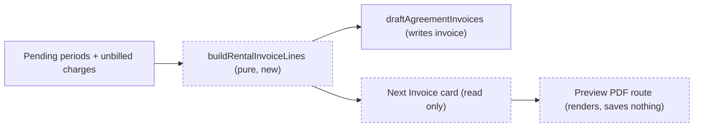

# Rental agreement: Next Invoice preview

> Status: Approved
> Author: aashu
> Date: 2026-11-20

## TLDR

- An Active rental agreement gets a **Next Invoice** card: the lines, tax and total of the invoice the next billing run will draft.
- A **Preview PDF** button renders that invoice with the company's sales invoice template.
- The preview saves nothing: no invoice, no sequence number, no billing period or charge is stamped.
- The card and the real drafting share one pure line builder, so the preview cannot disagree with the invoice.
- Rental lines print their description in the line's name cell on every sales invoice PDF (today that cell is blank).
- The billing schedule, the Invoice button and the daily job do not change.

## Overview diagram



## Problem Statement

A rental invoice exists only from the day its billing period is due. Before that day, the
Invoice button answers "Nothing is due on this agreement yet", and Sales Invoices has
nothing to open. A user who sets up an agreement wants to check the first invoice before
it is drafted: the rent lines, that the agreement's Tax Percent is applied, the total, and
how the document looks. Today they must wait for the due date.

The 2026-09-22 revenue recognition spec planned a read-only "Upcoming invoices" preview
for rentals (decision G4b, `.ai/runs/2026-10-02-contracts.md:163`; spec row 2 of the
decision table) and kept the schedule itself non-editable. The preview was never built.
This spec builds it. G4b's reasons (returns and holdover re-cut the schedule, sales-type
units must bill exactly, automation needs invoices fully set by the terms) apply to
editing or billing early, not to a read-only preview.

## Goals

- Show, on an Active agreement, exactly what the next billing run will draft.
- Let the user see that invoice as a PDF with the company template.
- Write nothing to the database.

## Non-goals

- Drafting or billing a period before its due date.
- Previewing more than the next invoice (the Billing Periods table already lists future periods).
- Previews for Draft agreements (they have no billing periods until activation).
- Editing the template from the preview. The company template is edited in Settings → Templates; a per-invoice edit needs a real invoice.
- Early-return credits. They go on a credit memo, not on the invoice.

## Proposed Solution

### Which invoice is "next"

`nextDueOn` = the earliest `dueOn` of the agreement's Pending, non-adjustment billing
periods (the `rentalAgreements` view already exposes it). The preview simulates a run
**as of `max(today, nextDueOn)`** with the same selection the drafter uses
(`sales.service.ts` `draftAgreementInvoices`): Pending non-adjustment periods with
`dueOn <= asOf`, and unbilled charges with `chargeDate <= asOf`. If no Pending period
exists and no charge is unbilled, the card says there is no upcoming invoice.

The preview does not run the drafter's roll-forward (`rollBillingPeriodsForward`).
Activation and the daily job keep periods cut one cycle past today (`billingHorizon`).
So the next period already exists.

### Shared line builder

Extract the inline line building of `draftAgreementInvoices` (`sales.service.ts`
~16104-16146) and the totals (~16274-16277) into pure functions:

- `buildRentalInvoiceLines({ agreement, periods, charges, exchangeRate })` → `LineValues[]` (rent line per period with `taxPercent = agreement.taxPercent`; charge line per charge with its own `taxPercent`).
- `rentalInvoiceTotals(lines)` → `{ subtotal, totalTax, totalAmount }`.

`draftAgreementInvoices` and `insertRentalInvoice` call them, with no change in output.
The preview calls the same functions, then `planRentalInvoices(effectiveMode, lines)` to
show the split (one invoice under Draft Only, rent and charges invoices otherwise) and any
hold reason.

### Read path

New building block `getRentalNextInvoice(db, { companyId, rentalAgreementId, today })` in
`sales.service.ts`. It reads the agreement, its Pending periods and unbilled charges (plain
`select`, no `FOR UPDATE`, no writes), the company invoice automation mode, and returns:

```ts
type RentalNextInvoice = {
  asOf: string;                       // the simulated run date
  invoices: Array<{
    lines: LineValues[];
    subtotal: number; totalTax: number; totalAmount: number;
    holdReason: string | null;
  }>;
} | null;                             // nothing upcoming
```

The details page loader (`$id.details.tsx`) calls it. It returns null unless the agreement is Active.

### Preview PDF

New file route `file+/rental-agreement+/$id.next-invoice[.]pdf.tsx`
(permission `view: "sales"` + `view: "invoicing"`, like the sales invoice PDF's `view: invoicing`).
It calls `getRentalNextInvoice`, then a new loader
`loadUnsavedSalesInvoiceDocument` in `packages/lib/src/sales-invoice-document.server.tsx` that
builds `SalesInvoicePDF` props in memory, reusing the pieces `loadSalesInvoiceDocument`
already uses: company, settings, `getCompanyTemplate` (no per-document edit),
`resolveSections`, terms, payment terms, shipping lists, currency decimals, the agreement
contact and Rental Site.

Synthesized header: `invoiceId` = "Preview", `dateIssued` = `asOf`,
`dateDue` = `computeInvoiceDateDue` from `asOf` and the payment term (the date posting would set if posted on
`asOf`), customer and addresses from the agreement. Synthesized lines set
`invoiceLineType "Rental"`, `quantity 1`, `unitPrice` and `convertedUnitPrice`,
`taxPercent`, `description`, `unitOfMeasureCode "EA"`. When the plan has two invoices the
route renders the rent invoice by default and the charges invoice with `?invoice=charges`.

The PDF opens in a new tab, as other document PDFs do.

### PDF fix: rental line name

`getLineDescription` in `packages/documents/src/utils/sales-invoice.ts` has no `Rental`
case, so a rental line (no item) prints a blank name cell and its text only in the detail
row. Add `Rental` to the item-less lines that are named by their description. This fixes
real rental invoices too. The printed-text snapshot (`pdf/preview-documents.test.ts`)
changes only if a sample has a rental line.

### Design Decisions

| Decision | Choice | Rationale |
|----------|--------|-----------|
| What the preview shows | Card with lines, tax, totals + Preview PDF | Covers both checks a user makes before sending: amounts/tax and layout |
| Which invoice | Only the next run, as of `max(today, nextDueOn)` | Matches what will actually be drafted; future periods are already in the Billing Periods table |
| Where | Next Invoice card above Billing Periods on the details page | Always visible on an Active agreement; mirrors the contract page's "Next invoice" row (`ContractSummary`) |
| Numbers source | One pure line builder shared with the drafter | The preview cannot drift from the real invoice |
| Writes | None; no roll-forward, no sequence, no rollback transaction | A rollback preview would still consume a sequence number and its rows are invisible to the Supabase PDF loader |
| Split under automation | Show every invoice `planRentalInvoices` returns, with hold reasons | Same plan the job uses |
| PDF header | Number "Preview", issued = run date, due = payment terms from that date | No real number exists; dates match what the run and posting would set |
| Template | Company template, no per-document edit | No invoice exists to carry an edit |
| Statuses | Active only | Draft has no periods; Closed only bills leftovers |
| Rental PDF line name | Fix in this PR | The preview would show the same blank cell |
| Permissions | Card: same as the page (`view: sales`); PDF: `view: sales` + `view: invoicing` | Same data the page shows; the PDF is an invoice document |

## Data Model Changes

N/A: no tables, columns or migrations. Read-only.

## API / Service Changes

- `sales.service.ts`: new pure `buildRentalInvoiceLines`, `rentalInvoiceTotals`; `draftAgreementInvoices` and `insertRentalInvoice` call them (no behavior change); new read `getRentalNextInvoice`.
- `packages/lib/src/sales-invoice-document.server.tsx`: new `loadUnsavedSalesInvoiceDocument` reusing the existing loaders' reads.
- New route `apps/erp/app/routes/file+/rental-agreement+/$id.next-invoice[.]pdf.tsx`; new `path.to.file.rentalNextInvoice(id, invoice?)`.
- `apps/erp/app/routes/x+/rental-agreement+/$id.details.tsx` loader: return `nextInvoice` for an Active agreement.
- `packages/documents/src/utils/sales-invoice.ts`: Rental lines named by description.

## Closest Sibling

AR contract: `ContractSummary.tsx` "Next invoice" row (`nextPlannedInvoice`) and the
expandable invoice rows of `ContractInvoices.tsx`. The rental card copies their look
(date, line count, total, expandable lines). Deviation: the rental card also offers a PDF,
which the contract page does not have, because the need includes checking the document.

## UI Changes

Details page (`$id.details.tsx`), record-detail archetype. New `RentalNextInvoice.tsx` in
`apps/erp/app/modules/sales/ui/Rentals/`, a card placed directly above `RentalBillingPeriods`:

- Title "Next Invoice", subtitle "Drafted on {asOf}. Nothing is saved until then."
- Per planned invoice: a table of lines (Description, Amount, Tax %, Tax, Total), then Subtotal, Tax, Total; a hold badge with its reason when held.
- A "Preview PDF" button (secondary, opens a new tab), hidden without `view: invoicing`.
- Empty state: "No upcoming invoice".
All labels through Lingui.

## Acceptance Criteria

- [ ] An Active agreement with one unit at £305.00/month, Tax Percent 20%, first period due in the future, shows a Next Invoice card dated that due date with one rent line £305.00, Tax £61.00, Total £366.00.
- [ ] Preview PDF opens a sales invoice PDF with number "Preview", the same line, £61.00 tax and £366.00 total, in the company's sales invoice template.
- [ ] Loading the card and the PDF creates no `salesInvoice`, no `opportunity`, consumes no `salesInvoice` sequence number, and leaves every period Pending and every charge unbilled (row counts and sequence value unchanged).
- [ ] With two units due on the same day and one unbilled charge dated before it, the card lists all three lines; the invoice drafted on that day by the Invoice button has the same lines and totals.
- [ ] Under a posting mode with a charge marked "invoice separately", the card shows two invoices, the charges one with its hold reason.
- [ ] A Draft agreement shows no card; an Active agreement with nothing Pending shows "No upcoming invoice".
- [ ] A posted rental invoice PDF prints the rental line description in the line's name cell.
- [ ] Existing rental drafting tests pass unchanged; a unit test pins `buildRentalInvoiceLines` and `rentalInvoiceTotals`.

## Risks

| Risk | Severity | Mitigation |
|------|----------|------------|
| Preview and real invoice drift | Med | Shared pure builder; acceptance test compares both |
| A return or charge added before the due date changes the invoice | Low | Card says it is a preview as of now; it recomputes on every load |
| Refactor of the drafter changes posted amounts | Med | Pure extraction, existing tests plus a new unit test |
| Extra reads on the agreement page | Low | Three small selects, Active only |

## Open Questions

- [x] What should the preview give the user? — **Answer:** lines + totals card and a Preview PDF.
- [x] Which invoice? — **Answer:** only the next one the run would draft.
- [x] Where does it live? — **Answer:** a Next Invoice card above Billing Periods.
- [x] Fix the blank rental line name on the PDF here? — **Answer:** yes, in this PR.

## Changelog

- 2026-11-20: Created
- 2026-11-20: Review fixes. The run date also counts the earliest unbilled charge date, so a future-dated charge with no rent left still shows. The pure planner moved to `@carbon/utils` `rental-invoice-plan.ts`; drafting and the preview share `planDueRentalInvoices`. A live test checks that the preview equals the drafted invoice and writes nothing. Known limit: the preview does not cut new periods, so it relies on activation and the daily run keeping the next period cut.
- 2026-11-20: Implemented on `feat/rental-invoice-preview`. The preview reads in the `$id.details` loader, not the `$id` shell loader, so other agreement pages do not pay for it. Browser check pending.
