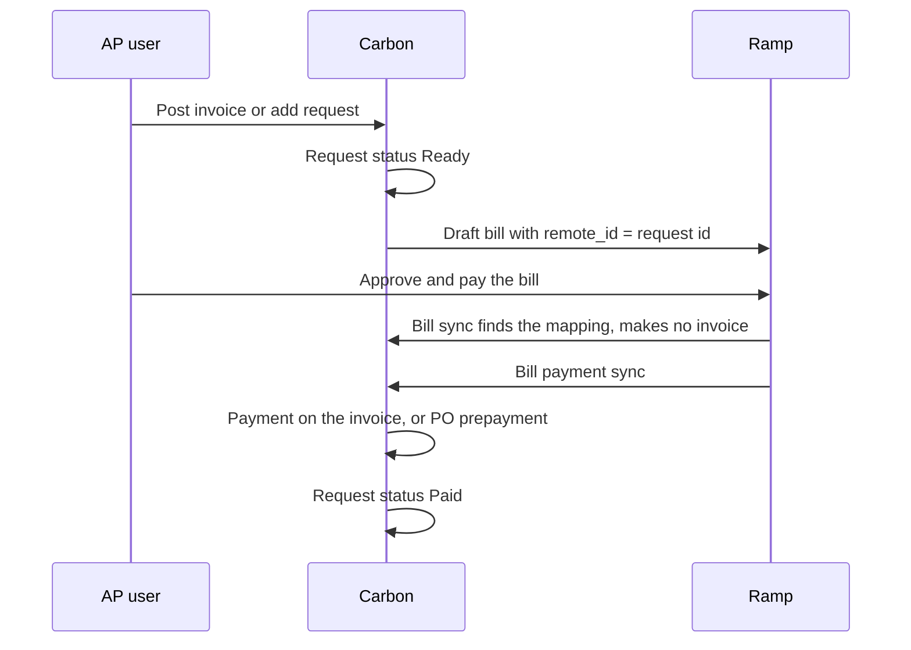
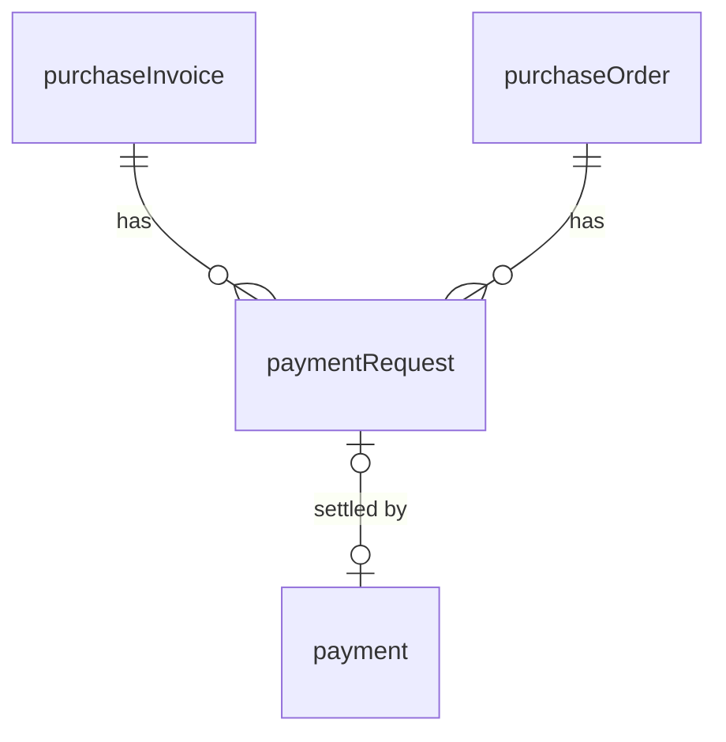

# Supplier Payment Requests

> Status: draft
> Author: Dane Albaugh (with Claude)
> Date: 2026-11-23
> Research: `.ai/research/supplier-prepayments-progress-billing.md`

## TLDR

A payment request says "pay this amount of this supplier invoice by this date".
A deposit request says the same for a purchase order that has no invoice yet.
Each request goes to Ramp as its own bill, and each Ramp payment comes back to
the invoice or the purchase order. Every bill that Carbon sends to Ramp now comes
from a payment request. A normal invoice gets one automatic request for its open
balance. A blanket invoice gets several requests, and the user marks each one
Ready when the supplier asks for the money. This removes the double AP that
happens today when a user enters the partial bill in Ramp. It also lets a
pre-cutover invoice, such as APV-000500, reach Ramp.

## Overview diagram



## Problem Statement

A customer buys on blanket terms. The supplier sends one invoice for the whole order.
The customer pays a lump sum up front. The supplier then charges the rest in parts, due
net 30 or before shipment. Sometimes a charge comes as a formal PDF, sometimes as
an email, and sometimes the user must remember it.

This example shows the case. The numbers are illustrative.

| Fact | Value |
|------|-------|
| Purchase order | PO-000300 |
| Invoice total | $100,000 |
| Paid up front | $50,000 |
| Open balance | $50,000 |
| Charge due now | about $20,000 |
| Payment term | "50% advance, 50% before shipping" (a name only) |
| Posting date | Before the accounting cutover |

Today the user cannot pay the $20,000 through Ramp:

1. The draft-bill push replays the invoice's Posted journal. A pre-cutover invoice has no Posted journal, so the push fails with `UNMAPPED_ACCOUNTS` (`packages/ee/src/accounting/core/document-costing.ts:233`).
2. The outbound reconcile looks back 7 days only (`SWEEP_LOOKBACK_DAYS`, `packages/jobs/src/inngest/functions/integrations/accounting-sync-operations.ts:1648`).
3. If the user enters the bill in Ramp, the `ramp-bills` sync posts a new purchase invoice. AP then shows $20,000 twice.
4. The push always sends the invoice's full total, not its open balance (`packages/ee/src/spend/bill-source.ts:285`). If a deposit already paid part of the invoice, Ramp pays the full total. The `ramp-bill-payments` sync then refuses the payment as more than the open balance.
5. Ramp can split one bill into at most 20 payments in its app. Its API returns only the first payment, so Carbon cannot sync the others.

The customer sometimes pays a supplier against a quote before an invoice exists. Carbon
records that as a supplier prepayment (`payment.purchaseOrderId`, account 1150,
migration `20261105213627_supplier-prepayments.sql`). Ramp has no prepayment
object, so that payment cannot go through Ramp today.

## Proposed Solution

### The payment request

A new record, `paymentRequest`, belongs to exactly one document:

| Target | Meaning | When Ramp pays it, Carbon creates |
|--------|---------|-----------------------------------|
| Purchase invoice | Pay this part of the invoice's open balance | A Posted AP payment settled against the invoice |
| Purchase order | Pay this deposit before an invoice exists | A Posted supplier prepayment (`payment.purchaseOrderId`), held on account 1150 |

The user calls both a "payment request". The purchase order view labels its
section "Deposit requests" for clarity, but the record and the status are the same.

### Status lifecycle

| Status | Meaning | Amount and due date |
|--------|---------|---------------------|
| Planned | Expected, not yet due. Carbon does not send it. | Either can be empty |
| Ready | Due. Carbon sends it to Ramp. | Both required |
| Sent | Ramp has the draft bill. Carbon set this when it wrote the mapping. | Locked |
| Paid | A Ramp payment, or a payment the user records by hand, settled it. | Locked |
| Cancelled | Not needed. If the request was Sent, the user discards the draft in Ramp by hand. | Locked |

Transitions:

1. Planned → Ready: the user marks it Ready.
2. Ready → Planned: the user moves it back. This is only possible before Carbon sends it.
3. Ready → Sent: the Ramp push succeeds.
4. Sent → Paid: the `ramp-bill-payments` sync applies the payment.
5. Planned, Ready or Sent → Cancelled: the user cancels it.
6. Planned or Ready → Paid: the user records a payment by hand and links the request.
7. Cancelled → Paid: a Ramp payment arrives for a request that Carbon sent before the user cancelled it. Carbon applies the payment. The Risks table describes this case.

### The automatic request

When a purchase invoice posts, Carbon checks 3 conditions:

1. A spend integration with bill push is active (`pushInvoices`, Ramp).
2. The supplier is not an Employee supplier.
3. The invoice has no request that is not Cancelled.

If all 3 are true, Carbon creates one request. Its amount is the open balance
after any prepayment is applied, and its due date is the invoice's `dateDue`.
Its status is Ready, so Carbon sends it at once. For a normal invoice this keeps
today's behavior, but with the open balance.

For a blanket invoice, the user plans the requests while the invoice is a
Draft. Then condition 3 is false, and Carbon makes no automatic request.

Posting runs in one Kysely transaction. It posts the invoice, applies the prepayments, and creates the automatic request. Carbon sends the Ramp push only after the commit.

### The open-balance guard

One building block, `getRequestAllowance`, computes the amount that a request may still use. The create and update operations call it. The `getPaymentRequestsForDocument` operation returns the same figure, so the card and the form show the same limit.

| Target | Allowance |
|--------|-----------|
| Purchase invoice | The open balance, minus the amounts of its requests that are not Paid or Cancelled. The open balance already excludes Paid payments. |
| Purchase order | The order total, minus the prepayments that have no request, minus the deposit requests that are not Paid or Cancelled. |

The service function locks the invoice row, or the purchase order row, with
`FOR UPDATE` in a Kysely transaction. It reads the allowance after the lock. Then it checks the new amount against it.

### Ramp: outbound

A new spend entity, `paymentRequest`, replaces the `purchaseInvoice` bill
entity on the event engine. The syncer creates one Ramp draft bill per request:

| Draft bill field | Value |
|------------------|-------|
| `remote_id` | The request id. The `ramp-bills` sync matches on it. |
| `vendor_id` | The Ramp spend vendor of the supplier (`resolveOrCreateRampSpendVendor`, as today) |
| `invoice_number` | The supplier reference, else the invoice or PO readable id, with the suffix `-R{requestNumber}` |
| `memo` | `APV-000500 · PO PO-000300 · request 2` |
| `due_date` | The request's due date |
| One line, `amount` | The request amount in document currency |
| Line coding, invoice request | The AP control account (`accountDefault.payablesAccount`) |
| Line coding, deposit request | The supplier prepayment account (`accountDefault.supplierPrepaymentAccount`) |
| Attachment | The request's PDF, if the user added one (`POST /bills/drafts/{id}/attachments`) |

The line is coded to a balance-sheet account because the request pays an amount
that Carbon has already recorded. It does not record a new expense. So the push
needs no Posted journal, and a pre-cutover invoice works.

The `ramp-outbound-reconcile` step reads Ready requests that have no mapping. It
uses the request status, not the 7-day posting-date window. So a request on an
old invoice still goes out. The operation also sends the outbound job after its commit, for speed. The reconcile sweep reads Ready requests anyway. So a missed event delays a request but does not lose it.

The outbound job runs safely on retry. The Ramp API has no idempotency key on `POST /bills`, so the job does this:

1. Read the Ready requests that have no mapping, in one query.
2. For each request, call `GET /bills?remote_id=<request id>`. If a bill exists, skip step 3 and go to step 4.
3. Create the draft bill. `remote_id` works only with `enable_accounting_sync: true`.
4. In one transaction, save the mapping and set the request to Sent with `WHERE status = 'Ready'`.

If the job stops after step 3 and before step 4, the next run finds the bill in step 2. It sets Sent and creates no second bill.

### Ramp: inbound

1. **`ramp-bills`**: if a bill's `remote_id` is a request id, the mapping already exists. The sync confirms the bill and creates no invoice.
2. **`ramp-bill-payments`**: if the bill maps to a request, the sync applies the payment as follows:
   1. For an invoice request, create a Posted AP payment settled against the invoice. Use the existing `upsertLocalPaymentDraft` path. The open-balance check stays.
   2. For a deposit request, create a Posted supplier prepayment with `purchaseOrderId` set.
   3. Set `paymentRequest.paymentId` and the status Paid.
3. If Ramp paid an amount that differs from the request, Carbon records the amount Ramp paid. Carbon also writes a Sync Activity `Warning`.
4. Bills that Carbon pushed before this change keep the `bill` mapping to the invoice. Their payments sync as today.
5. Ramp split payments and Ramp vendor credits stay refused. The Sync Activity message tells the user to add requests in Carbon instead.
6. Apply each payment through `settlePaymentRequest`, inside one transaction. A repeated sync of the same Ramp payment finds the request already Paid and stops.

### The deposit is applied when the invoice arrives

When a purchase invoice from a purchase order posts, Carbon applies that order's
unapplied prepayments to the invoice, up to its open balance. This matches how
the customer works: the lump sum applies to the whole invoice up front. Then the
automatic-request check runs on the balance that remains.
<!-- UNVERIFIED: whether posting already applies PO prepayments. /plan confirms
the current behavior in createPayment / the payment application flow and changes
only what is missing. -->

### One settlement path

Two callers record that a payment settled a request: the `ramp-bill-payments` sync (transitions 4 and 7) and `linkPaymentRequestPayment` (transition 6). Both call one building block, `settlePaymentRequest(db, { requestId, paymentId })`. It sets `paymentId`, sets Paid, and changes the row only from an allowed status. The caller runs it inside its own transaction. No other code writes the Paid status.

### Design Decisions

| Decision | Choice | Rationale |
|----------|--------|-----------|
| Base model for blanket buying | One supplier invoice for the order, paid down through payment requests | The supplier sends one invoice and does not always send new invoice numbers for later charges (Q1). |
| How requests get onto a document | Plan ahead as Planned, or add one when a charge comes in. Only Ready requests go to Ramp. | The user sometimes must remember a charge. Planned requests show what is still to come (Q2). |
| Paying against a quote | Convert the quote to a PO first. The deposit request sits on the PO. | Paying is a commitment. Carbon's supplier prepayment already sits on the PO (Q3b). |
| Path into Ramp | Every Ramp bill comes from a request. A normal invoice gets one automatic request. | One path in and one path out. It also fixes the deposit overpayment (Q4). |
| Formal blanket PO records | Out of scope | The user needs the lump sum plus charges only (Q6). |
| Installment payment terms | Out of scope | The user deferred them (Q5). Requests are planned by hand. |
| Ramp split payments and vendor credits | Stay refused, with a clear Sync Activity message | The user does not need them (Q6). The API exposes only the first split payment and cannot create credits (research). |
| Delivery | One delivery, no phases | The user's choice (Q7). |
| Closest sibling | `contractFinancingRequest` | It is a numbered request on a document that ends in a payment. |
| Record name | `paymentRequest`, id prefix `preq` | No table uses the name. The customer side uses `contractFinancingRequest`, so the two names do not collide. |
| Ramp line coding | AP control account, or the supplier prepayment account | The request pays an existing liability or funds an asset. A Posted journal is not needed. |
| Ramp `invoice_number` | Supplier reference plus `-R{n}` | Each Ramp bill needs its own number. Ramp dedupes bills on vendor and invoice number. |
| Outbound selection | By status Ready, not by a posting-date window | A request on an old invoice must still go out. |
| Automatic request when no spend integration | No automatic request | Without Ramp, an automatic request on every invoice adds no value. |
| Amount Ramp paid differs from the request | Record Ramp's amount, warn in Sync Activity | Carbon must match the cash that left the bank. |
| Heuristic 1, multi-tenancy | `companyId`, composite PK `("id", "companyId")`, `id('preq')` | Carbon rule. |
| Heuristic 2, service shape | `defineServiceFn` operations in `invoicing.server.ts`. Building blocks take `db` and run in a Kysely transaction. | `module-files.md`. The guard needs a row lock. |
| Heuristic 3, RLS | SELECT, INSERT, UPDATE and DELETE policies on invoicing permissions | Same as `payment`. |
| Heuristic 4, permissions | `{ view: "invoicing" }`, `{ create: "invoicing" }`, `{ update: "invoicing" }` | Requests pay money, like payments. |
| Heuristic 5, forms | `ValidatedForm` with `paymentRequestValidator` and a route action | Carbon rule. |
| Heuristic 6, module layout | Invoicing module files. No new module. | A request is a part of AP. |
| Heuristic 7, backward compatibility | Bills that are already mapped keep the `bill` path. The `purchaseInvoice` push stops for new invoices only. | No existing Ramp bill changes. |
| Lifecycle | Service function with a conditional update. No database trigger. | The database holds shape rules only (CHECK constraints). Retry logic belongs in the service. |
| Outbound trigger | No database event trigger. The sweep reads Ready requests. The operation also sends the job after commit. | A missed event delays a request but does not lose it. |
| Retry, outbound | Look up by `remote_id` before create. Set Sent with a conditional update. | The Ramp API has no idempotency key on bill create. |
| Retry, inbound | `settlePaymentRequest` changes only from an allowed status. | A repeated sync must not pay a request twice. |
| Retry, create | `idempotencyKey` on `createPaymentRequest`. | A double submit must not add a second request. |
| Allowance | One building block, `getRequestAllowance`. | Three callers need the same limit: the guard, the card and the form. |

## Data Model Changes



```sql
CREATE TYPE "paymentRequestStatus" AS ENUM (
  'Planned', 'Ready', 'Sent', 'Paid', 'Cancelled'
);

CREATE TABLE "paymentRequest" (
  "id" TEXT NOT NULL DEFAULT id('preq'),
  "companyId" TEXT NOT NULL,
  "purchaseInvoiceId" TEXT,
  "purchaseOrderId" TEXT,
  "requestNumber" INTEGER NOT NULL,
  "status" "paymentRequestStatus" NOT NULL DEFAULT 'Planned',
  "amount" NUMERIC,
  "currencyCode" TEXT NOT NULL,
  "dueDate" DATE,
  "description" TEXT,
  "documentPath" TEXT,
  "isAutomatic" BOOLEAN NOT NULL DEFAULT false,
  "paymentId" TEXT,
  "createdBy" TEXT NOT NULL REFERENCES "user"("id"),
  "createdAt" TIMESTAMP WITH TIME ZONE NOT NULL DEFAULT NOW(),
  "updatedBy" TEXT REFERENCES "user"("id"),
  "updatedAt" TIMESTAMP WITH TIME ZONE,
  "customFields" JSONB,
  "idempotencyKey" TEXT,
  CONSTRAINT "paymentRequest_pkey" PRIMARY KEY ("id", "companyId"),
  CONSTRAINT "paymentRequest_companyId_fkey" FOREIGN KEY ("companyId")
    REFERENCES "company"("id") ON DELETE CASCADE,
  CONSTRAINT "paymentRequest_invoice_fkey" FOREIGN KEY ("purchaseInvoiceId", "companyId")
    REFERENCES "purchaseInvoice"("id", "companyId") ON DELETE CASCADE,
  CONSTRAINT "paymentRequest_order_fkey" FOREIGN KEY ("purchaseOrderId", "companyId")
    REFERENCES "purchaseOrder"("id", "companyId") ON DELETE CASCADE,
  CONSTRAINT "paymentRequest_payment_fkey" FOREIGN KEY ("paymentId", "companyId")
    REFERENCES "payment"("id", "companyId"),
  -- Exactly one target document.
  CONSTRAINT "paymentRequest_target_check"
    CHECK (num_nonnulls("purchaseInvoiceId", "purchaseOrderId") = 1),
  CONSTRAINT "paymentRequest_amount_check" CHECK ("amount" IS NULL OR "amount" > 0),
  -- A request that is not Planned or Cancelled has an amount and a due date.
  CONSTRAINT "paymentRequest_ready_check" CHECK (
    "status" IN ('Planned', 'Cancelled')
    OR ("amount" IS NOT NULL AND "dueDate" IS NOT NULL)
  ),
  CONSTRAINT "paymentRequest_paid_check" CHECK (("status" = 'Paid') = ("paymentId" IS NOT NULL))
);

CREATE UNIQUE INDEX "paymentRequest_invoice_number_key"
  ON "paymentRequest" ("purchaseInvoiceId", "requestNumber", "companyId")
  WHERE "purchaseInvoiceId" IS NOT NULL;
CREATE UNIQUE INDEX "paymentRequest_order_number_key"
  ON "paymentRequest" ("purchaseOrderId", "requestNumber", "companyId")
  WHERE "purchaseOrderId" IS NOT NULL;
CREATE INDEX "paymentRequest_status_idx" ON "paymentRequest" ("companyId", "status", "dueDate");
CREATE UNIQUE INDEX "paymentRequest_idempotency_key"
  ON "paymentRequest" ("companyId", "idempotencyKey")
  WHERE "idempotencyKey" IS NOT NULL;

ALTER TABLE "paymentRequest" ENABLE ROW LEVEL SECURITY;
-- SELECT / INSERT / UPDATE / DELETE policies on invoicing permissions, same shape as "payment".
-- No event trigger. See "Ramp: outbound".
```

The database does not enforce the lifecycle with a trigger. The service layer does:

1. The building block `transitionPaymentRequest` checks the move against "Status lifecycle".
2. It updates the row with `WHERE id = ? AND status = <current status>`. A repeated or stale call then changes no row.
3. Once the status is Sent, Paid or Cancelled, it refuses changes to `amount`, `dueDate` and the target.

The CHECK constraints stay. They hold for every row, so they belong in the schema. The payment foreign key has no `ON DELETE` action. `SET NULL` would clear `paymentId` on a Paid row and break `paymentRequest_paid_check`.

Other changes:

| Change | Where |
|--------|-------|
| `REQUIRED_SYNC_SUBSCRIPTIONS[ramp]` adds `paymentRequest` | `packages/ee/src/accounting/core/subscriptions.ts` |
| New entity type `paymentRequest` for the spend provider | `packages/ee/src/spend/`, `packages/ee/src/ramp/entities/` |
| `purchaseInvoice` bill push stops for invoices with no existing mapping | `packages/ee/src/ramp/entities/bill.ts`, `packages/ee/src/spend/gates.ts` |

## API / Service Changes

New operations in `apps/erp/app/modules/invoicing/invoicing.server.ts`, each `@mcp`:

| Operation | Permission | Does |
|-----------|------------|------|
| `getPaymentRequests` | view invoicing | Lists requests. Filters: status, supplier, document, due date. |
| `getPaymentRequestsForDocument` | view invoicing | Lists the requests of one invoice or one PO, with the open balance. |
| `createPaymentRequest` | create invoicing | Adds a request. Runs the guard. Assigns the next `requestNumber`. Takes an `idempotencyKey`. A repeated call with the same key returns the first request. |
| `updatePaymentRequest` | update invoicing | Edits a Planned or Ready request. Runs the guard. |
| `markPaymentRequestReady` | update invoicing | Planned → Ready. Requires an amount and a due date. |
| `markPaymentRequestPlanned` | update invoicing | Ready → Planned. Refused once Carbon sends the request. |
| `cancelPaymentRequest` | update invoicing | Sets Cancelled. If the request was Sent, the result says to discard the draft in Ramp. |
| `linkPaymentRequestPayment` | update invoicing | Links a payment that the user recorded by hand. Sets Paid. |

Changed code:

| Code | Change |
|------|--------|
| `postPurchaseInvoice` (posting) | Applies the PO's unapplied prepayments. Then creates the automatic request. |
| `ramp-sync-bill.ts`, `ramp-sync-bill-stage.ts` | Treats a `remote_id` that is a request id as mapped. Creates no invoice. |
| `ramp-sync-payment.ts` | Applies a payment for a request bill to the invoice or as a PO prepayment. Sets the request Paid. |
| `ramp-sync-outbound.ts` (`loadRampOutboundCandidates`) | Selects Ready requests with no mapping, with no date window. |
| `.claude/rules/ramp-integration.md` | Describes the request path and the end of the whole-invoice push. |

## Closest Sibling

`contractFinancingRequest` (customer contract financing). It is a numbered
request on a document, with a status lifecycle, that ends in a deposit payment
(`paymentId`).

| Sibling file | This feature copies it as |
|--------------|---------------------------|
| `packages/database/supabase/migrations/20261021012500_contract-financing.sql` (`contractFinancingRequest`) | The table shape: number, status, amount, `paymentId` |
| `apps/erp/app/routes/x+/contract+/$id.financing.tsx` | `x+/purchase-invoice+/$invoiceId.payment-requests.tsx` and the PO equivalent |
| `apps/erp/app/routes/x+/contract+/$id.financing.$requestId.tsx` | `...payment-requests.$requestId.tsx` (edit modal route) |
| `apps/erp/app/modules/sales/ui/Contracts/ContractFinancing.ee.tsx` | `apps/erp/app/modules/invoicing/ui/PaymentRequest/PaymentRequests.tsx` |

Deviations, each in the Design Decisions table:

1. The sibling numbers a request on Submit. A payment request gets its number when the user creates it, because a Planned request must be referable.
2. The sibling is commercial (`.ee.tsx`). Payment requests are community code, because AP is community.
3. The sibling has a request date and an approved amount. A payment request has a due date and one amount.

## UI Changes

Archetype: record detail section plus a list page, the same as the sibling.

1. **Purchase invoice detail.** A "Payment requests" card sits above the Payments panel (`InvoicePaymentsPanel`). It shows the open balance, the planned total, and one row per request: number, status, due date, amount, PDF, and the Ramp link. The card has actions to add a request, mark one Ready, and cancel one.
2. **Purchase order detail.** A "Deposit requests" card with the same rows and actions.
3. **Draft invoice.** The user can add Planned requests before posting. The post modal says "No automatic request: this invoice has 2 planned requests."
4. **Invoicing → Payment requests.** A list page of all requests: Planned and Ready first, sorted by due date. Filters: status, supplier, due date. This page shows what the user must remember.
5. **Add or edit form (modal).** Fields: amount, due date, description, PDF, status Planned or Ready. The form shows the remaining amount that the guard allows.

Data and rules. The API decides every rule. The UI shows hints only.

- Each card makes one call, to `getPaymentRequestsForDocument`. The card shows the balance and allowance that the call returns. It computes neither.
- The list page asks only for the columns it shows, in cursor pages.
- After a status change, the page refreshes its data through the action hook in `packages/query`. The UI uses no `useEffect`.

All new strings use Lingui and go through `/translate`.

## Acceptance Criteria

- [ ] On APV-000500 (open $50,000), the user adds a Ready request for $20,000. Ramp receives one draft bill for $20,000, coded to the AP control account, with invoice number `INV-7731-R1`.
- [ ] The user pays that bill in Ramp. After the next `ramp-sync`, APV-000500 shows a Posted payment of $20,000 and an open balance of $30,000. The request shows Paid. No new purchase invoice exists.
- [ ] The user adds a second request of $35,000 to APV-000500. The guard refuses it and shows that $30,000 is the most allowed.
- [ ] The user posts a normal $5,000 invoice while Ramp is connected. Carbon creates one automatic Ready request for $5,000. Ramp receives one $5,000 draft bill.
- [ ] The user posts a $20,000 invoice from a PO with an $8,000 unapplied prepayment. Carbon applies $8,000. The automatic request is $12,000, and Ramp receives a $12,000 bill.
- [ ] The user adds 2 Planned requests to a Draft invoice and posts it. Carbon creates no automatic request, and Ramp receives no bill.
- [ ] The user adds a Ready deposit request of $50,000 on a PO with no invoice. Ramp receives a $50,000 bill coded to the supplier prepayment account. After Ramp pays it, the PO has a Posted prepayment of $50,000 on account 1150.
- [ ] A Ready request on an invoice posted 60 days ago goes to Ramp at the next sync.
- [ ] A Ramp bill that Carbon pushed before this change still syncs its payment to its invoice.
- [ ] The user cancels a Sent request. The status is Cancelled, and the message tells the user to discard the draft in Ramp.
- [ ] Ramp pays $19,000 on an $20,000 request. Carbon records $19,000, sets the request Paid, and writes a Sync Activity `Warning`.
- [ ] The Invoicing → Payment requests page lists Planned and Ready requests by due date for one company only.
- [ ] A Ramp payment arrives for a request the user cancelled after Carbon sent it. Carbon applies the payment, and the request shows Paid.
- [ ] Two submits of the same create form add one request.
- [ ] A retried outbound run, after a failed save of Sent, creates one Ramp bill.

## Risks

| Risk | Severity | Mitigation |
|------|----------|------------|
| Ramp may refuse a bill line coded to an AP (liability) account | High | Test in the Ramp sandbox first. If Ramp refuses, code the line to a clearing account that Carbon then settles. Decide before the outbound code is written. |
| Ramp may dedupe or reject the suffixed `invoice_number` | Med | Test `-R1` and `-R2` on the same vendor in the sandbox. |
| A Sent request is cancelled in Carbon, but its draft stays in Ramp and is paid | Med | The payment still applies, because it is within the open balance. The request shows Paid, and Sync Activity warns. |
| Changing the push path breaks bills that are already in Ramp | High | Mapped invoices keep the `bill` path. A test covers an old mapped bill paying through. |
| Posting now applies prepayments on its own | Med | Apply only prepayments of the invoice's own PO, up to the open balance. Cover it with a database test. |
| Discarding a draft in Ramp's app is unverified | Low | Confirm in the sandbox. Document the exact steps in the cancel message. |
| Ramp creates a bill, then Carbon fails to save Sent | Med | The retry looks up the bill by `remote_id` first (Ramp: outbound, step 2). |
| A repeated payment sync pays a request twice | Med | `settlePaymentRequest` changes only from an allowed status. |

## Open Questions

> HARD STOP: Do not proceed with implementation until these are answered.

- [x] Q1. How is a blanket deal recorded? — **Answer:** One supplier invoice for the whole order, paid down in parts. The supplier sends a PDF, an email, or nothing for each charge, so the original invoice stays the record.
- [x] Q2. How do requests get onto an invoice, and when do they go to Ramp? — **Answer:** Plan ahead as Planned, or add when charged. Only Ready requests with an amount go to Ramp.
- [x] Q3. Does the customer pay before an invoice exists? — **Answer:** Yes, against a quote, sometimes.
- [x] Q3b. Must the quote become a PO first? — **Answer:** Yes. The deposit request sits on the PO.
- [x] Q4. Does every Ramp bill come from a request? — **Answer:** Yes. A normal invoice gets one automatic request for its open balance.
- [x] Q5. What does v1 defer? — **Answer:** Installment payment terms.
- [x] Q6. What must a formal blanket PO do? — **Answer:** Nothing beyond the lump sum plus charges. Formal blanket PO records are out of scope. Ramp split payments and vendor credits are out of scope, because the user needs only the flows above.
- [x] Q7. Phased or one delivery? — **Answer:** One delivery.

## Changelog

- 2026-11-23: Created after the Q1 to Q7 interview with the user.
- 2026-11-23: Reviewed against the backend and frontend conventions. Removed the database lifecycle trigger and the event trigger. Added retry safety, one allowance helper and one settlement path. Fixed the payment foreign key. Added the Cancelled → Paid transition and the Ready → Planned operation.
