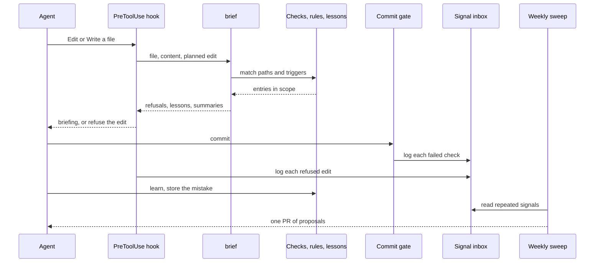

# Agent context briefing and the learning loop

> Status: draft
> Author: naveenkash
> Date: 2026-11-24
> Research: `.ai/research/2026-11-24-agent-context-briefing.md`

## TLDR

An agent must know the rules, the checks and the past lessons for a file
before it writes the file. Today it learns most of them only when the commit
fails. This spec gives each rule, check and lesson a scope: file paths
(`paths:`) and code text (`triggers:`). One lookup, `brief`, returns only the
entries whose scope matches a file or a planned edit. A Claude Code hook runs
`brief` before each edit, and refuses an edit that a check would fail. A
learning loop records each mistake in the strongest store that fits it.
Automatic signals and a weekly sweep catch the mistakes that an agent does not
record itself.

## Overview diagram



## Problem Statement

1. **The checks reach the agent too late.** The 51 checks in `packages/checks`
   run at commit time. The write-time checklist names their ids only. So the
   agent writes the code, the commit fails, and the agent rewrites the code.
2. **The lessons do not reach the agent.** `.ai/lessons.md` has 421 entries,
   about 140k tokens. Root `AGENTS.md` tells every agent to read it, but no
   agent can load it. Nothing selects the lessons for one file.
3. **Path scope misses cross-cutting topics.** Each of the 89 rules loads when
   the agent opens a file that matches its `paths:`. The transaction rule
   (`database-patterns.md`) covers `*.service.ts`. The lesson "Chained Supabase
   writes in a route action are not a transaction" is about route files, which
   the rule does not cover.
4. **Learning depends on memory.** "After corrections, update
   `.ai/lessons.md`" works only when the agent remembers. A skipped entry is
   lost. An entry that is written goes into the file that no agent reads.
5. **The lessons file grows without limit.** 77 commits changed it in the last
   month. Duplicate lessons accumulate, and parallel branches conflict on it.

## Proposed Solution

### 1. Three stores, each entry with one scope

The design stores each entry once. Its scope is a set of path globs, a set of
triggers, or both.

| Store | Location | Scope | The briefing shows |
|---|---|---|---|
| Check | `packages/checks/src/conformance/*.ts` | The file set in `run.ts`, and the new `triggers` field | The violation message and `provenance.replacedBy` |
| Rule | `.claude/rules/*.md` | `paths:` (kept), new `triggers:` | The new `summary:` lines and the rule path |
| Lesson | `.ai/lessons/*.md`, one file per lesson | `paths:`, `triggers:` | The title and the Rule line |

A rule keeps its `paths:`. Claude Code reads only that field, and it loads a
rule with no `paths:` in every session. So Claude Code still loads a rule when
the agent opens a matching file. The new fields are for `brief` only.

**Triggers.** A trigger is a plain substring. Matching is case-sensitive. One
matching trigger selects the entry. The object form `{ text, minCount }`
selects the entry only when the text occurs at least `minCount` times.

Example, the transaction rule:

```yaml
---
paths:
  - "packages/database/**"
  - "apps/erp/app/modules/**/*.service.ts"
triggers:
  - "ctx.transaction"
  - "db.transaction("
  - { text: ".insert(", minCount: 2 }
  - { text: ".update(", minCount: 2 }
summary:
  - "Chained supabase-js writes are not a transaction. Use ctx.transaction, or a building block that takes db."
---
```

**Summary.** Each rule gets 1 to 5 `summary:` lines in the form "Do X, not Y".
The briefing shows the summary and the rule path. The agent opens the full
rule only when it needs the detail. The median rule is about 3.4k tokens, so
the briefing never pastes a full rule.

**Lesson file.**

```markdown
---
paths: ["apps/erp/app/modules/*/ui/**/*Dashboard*"]
triggers: ["purchaseInvoice", "salesInvoice"]
promoted: null
---
# Count invoices by the status the list shows, from its view

**Problem:** …
**Rule:** …
```

`promoted` holds `check:<id>` or `rule:<file>` when a stronger store takes the
lesson over. The commit that sets `promoted` deletes the lesson file.

### 2. The lookup: `brief`

`brief` lives in `packages/checks`. That package already owns the file sets,
the baseline and the scanners.

1. `brief` reads a file path, the current file content and the planned edit.
2. It selects each check whose file set holds the path and whose trigger
   occurs in the content or the edit.
3. It runs those checks on the file as it would be after the edit. It keeps
   only the violations that are not in `baseline.json`.
4. It selects each rule and each lesson whose `paths:` matches the path, or
   whose trigger occurs in the content or the edit.
5. It prints at most about 2k tokens, in this order: check violations,
   lessons, rule summaries. It lists the entries past the limit by name only.

A generated index (`packages/checks/brief-index.json`) holds every entry's
scope and summary, so the lookup does not parse 89 rules and 421 lessons on
each edit. A test fails when the index is stale, as `check:manifest` does for
the MCP manifest.

Command: `pnpm brief <file> [<file> …]`. With no planned edit, `brief` matches
the current content only.

### 3. How the briefing reaches the agent

| Path | Agent | When |
|---|---|---|
| `PreToolUse` hook on `Edit` and `Write` | Claude | Before each edit |
| `pnpm brief <files>` | Every agent, Codex included | Root `AGENTS.md` tells the agent to run it before an edit |
| A step in `/plan`, `/execute` and `/fix` | The skill | Before the skill writes code. `/plan` puts each task's briefing into the plan |
| The pre-commit gate | Every commit | Unchanged |

The hook:

1. The hook reads `tool_name`, `tool_input` and `session_id` from stdin.
2. The hook calls `brief` with `file_path` and the planned edit (`new_string`
   for `Edit`, `content` for `Write`).
3. If `brief` returns a new check violation, the hook returns
   `permissionDecision: "deny"`. The reason is the violation message and its fix.
4. Otherwise the hook returns the briefing in
   `hookSpecificOutput.additionalContext`.
5. The hook shows each entry once per session. It keeps the ids it showed in
   the session's scratch folder.

A timed-out command hook does not block the tool call, so a slow or broken
hook never stops the work.

### 4. The learning loop: `/learn`

`/learn` records one mistake.

1. Search the three stores for the same mistake. If an entry exists, make it
   stronger instead of adding a new one.
2. Choose the strongest store that fits:
   1. A check, if the mistake shows in the code text.
   2. Else a rule line in the rule for that topic.
   3. Else a lesson file.
3. Prove the entry. A new check must fail on the code that had the mistake.
4. Commit through `/check-and-commit`.

These skills call `/learn`:

| Caller | When |
|---|---|
| Root `AGENTS.md` | The user corrects the agent |
| `/fix` | Its last step, when the root cause was an earlier agent's mistake |
| `/self-review` | Each Must-fix finding |
| `/check-and-commit` | The same check failed a second time on the branch |

`/learn` may add an entry, promote a lesson, and delete the promoted lesson in
the same commit. It must not delete a lesson that it did not promote. That
needs a human yes.

### 5. Mistakes that no agent records

1. **Automatic signals.** These events write one JSONL line each to the signal
   inbox, `~/.carbon/learn-inbox.jsonl`:
   - The pre-commit gate fails a check: check id, file, branch.
   - The hook refuses an edit: check id, file.
   - A `fix:` commit changes a file that an agent commit changed in the 14
     days before it: both commit ids.
2. **Stop hook.** When the agent is about to end its turn, a `Stop` hook reads
   the inbox. If the session logged a signal and did not run `/learn`, the hook
   blocks the stop once. Its reason tells the agent to run `/learn`. It blocks
   at most once per session.
3. **Correction nudge.** A `UserPromptSubmit` hook adds one line to each user
   message: "If this message corrects you, run `/learn` before you continue."
4. **Weekly sweep.** A scheduled run reads the inbox and the CI failures on
   pull requests (through `gh`). It proposes a change only when a signal
   repeats 2 or more times. It opens one pull request with all proposals, and
   a human reviews it.

### 6. Tests that keep the scopes honest

These tests live in `packages/checks` and run with `pnpm test`.

1. The frontmatter of every rule and every lesson parses. A rule with broken
   frontmatter loads in every session.
2. Each trigger has at least 4 characters.
3. Each trigger matches at most 25% of the repository's source files.
4. No check reports a violation in a file that has none of its triggers.
5. Each rule has 1 to 5 `summary:` lines.
6. `brief-index.json` equals the index built from the sources.

### 7. Rollout

| Phase | Work |
|---|---|
| 1. Lookup | Add `triggers` to `ConformanceCheck`. Add `triggers:` and `summary:` to the 89 rules. Build `brief`, the index and the tests in section 6. |
| 2. Hook | Add the `PreToolUse` hook to `.claude/settings.json`. First prove that `additionalContext` reaches the agent. |
| 3. Lessons | Split `.ai/lessons.md` into `.ai/lessons/*.md` with a script. Agents add `paths:` and `triggers:` and flag lessons that a rule or check already covers, one area at a time. A human approves each area's deletions. |
| 4. Learning | Add `/learn`, the steps in `/plan`, `/execute`, `/fix`, `/self-review` and `/check-and-commit`, the signal inbox, the `Stop` and `UserPromptSubmit` hooks, the weekly sweep, and the root `AGENTS.md` lines. |

### Design Decisions

| Decision | Choice | Rationale |
|---|---|---|
| Rule scope fields | Keep `paths:`. Add `triggers:` to every rule. | A rule without `paths:` loads in every session (about 485k tokens for all 89). Triggers reach topics that paths miss. |
| Trigger syntax | Plain substrings, plus `{ text, minCount }` | Agents write substrings correctly. `minCount` expresses "two writes". A regex fails silently when it is wrong. |
| Trigger input | The current content and the planned edit | A new file has no content. The topic often arrives with the edit. |
| Rule text in the briefing | `summary:` lines and the rule path | Rules are too long to paste. |
| Hook frequency | Before each edit, each entry once per session | A new topic shows the first time. A repeat adds nothing. |
| Check refusal | The hook refuses a write with a new check violation. Baselined violations pass. | The agent fixes the code before it exists. Old code never blocks. |
| Check scope | The existing file set in `run.ts`, plus `triggers` | No duplicate scope list. Test 4 keeps the triggers true. |
| Lesson storage | One file per lesson in `.ai/lessons/` | Each lesson is found, promoted or deleted alone. No merge conflicts on one file. |
| Lesson migration | A script splits the file. Agents add scopes per area. A human approves deletions. | The split is exact. Scopes and duplicates need judgment. |
| `/learn` permissions | Add, promote, and delete a promoted lesson. A plain deletion needs a human. | A promotion keeps the knowledge. A deletion loses it. |
| Agents without hooks | `pnpm brief` is the main entry point. The hook is extra. | Codex does not read `paths:` and does not run Claude hooks. |
| Briefing size | About 2k tokens per edit | It stays readable. A file at the limit needs a check. |
| Signal inbox | `~/.carbon/learn-inbox.jsonl` on the machine; CI failures through `gh` | Worktrees cannot see each other's gitignored files. |
| Sweep | Weekly, a proposal only for a signal that repeats 2 or more times | A one-off typo never becomes a rule. A human reviews the pull request. |
| Commit-message gate on `fix:` | Not in v1 | It adds friction to every fix. Add it only if the sweep shows that fixes still slip through. |
| Heuristic 1, multi-tenancy | N/A | No table changes. |
| Heuristic 2, service shape | N/A | No service function changes. |
| Heuristic 3, RLS | N/A | No table changes. |
| Heuristic 4, permissions | N/A | No routes. |
| Heuristic 5, forms | N/A | No forms. |
| Heuristic 6, module layout | `brief` goes in `packages/checks/src/brief/`. No ERP module changes. | It reuses the file sets and the baseline in that package. |
| Heuristic 7, backward compatibility | `ConformanceCheck` gains a required `triggers` field. All 51 checks change in phase 1. | The type is internal to `@carbon/checks`. No product surface changes. |

## Data Model Changes

N/A. No database tables or migrations. The changes are frontmatter fields, one
TypeScript type field, one generated JSON index and one JSONL file on the
machine.

| File | Change |
|---|---|
| `.claude/rules/*.md` | New `triggers:` and `summary:` frontmatter |
| `packages/checks/src/check.ts` | `ConformanceCheck` gains `triggers` |
| `.ai/lessons/*.md` | New directory. One lesson per file |
| `.ai/lessons.md` | Replaced by `.ai/lessons/README.md` |
| `packages/checks/brief-index.json` | New generated index |
| `~/.carbon/learn-inbox.jsonl` | New signal inbox, outside the repository |

## API / Service Changes

| Item | Change |
|---|---|
| `pnpm brief <files>` | New command (`packages/checks/src/brief/`) |
| `pnpm brief:index` | New command. Rebuilds `brief-index.json` |
| `.claude/settings.json` | New `PreToolUse`, `Stop` and `UserPromptSubmit` hooks |
| `scripts/git-hooks/pre-commit` | Logs each failed check to the signal inbox |
| `.claude/skills/learn/SKILL.md` | New skill |
| `/plan`, `/execute`, `/fix`, `/self-review`, `/check-and-commit` | New steps (section 3 and section 4) |
| Root `AGENTS.md` | "Run `pnpm brief` before you edit a file." "After a correction, run `/learn`." The line "Read `.ai/lessons.md`" goes. |

## Closest Sibling

N/A for a record type: this is developer tooling. The closest tooling precedents are:

| Part | Precedent it copies |
|---|---|
| Generated index and its staleness test | The MCP manifest (`pnpm generate:mcp`, `pnpm check:manifest`) |
| Index next to the scanners and the baseline | `packages/checks/src/run.ts` and `baseline.ts` |
| Hook that logs check failures | The conformance step in `scripts/git-hooks/pre-commit` |
| Copies for Codex | `.ai/scripts/install-skills.sh` |

## UI Changes

N/A. No product UI. The agent sees the briefing as text in its context.

## Acceptance Criteria

- [ ] `pnpm brief apps/erp/app/routes/x+/<a route that calls .update( twice>.tsx` lists the transaction rule summary, though route files are not in the rule's `paths:`.
- [ ] An `Edit` that adds `import { redirect } from "react-router"` to a route file gets a refusal from the hook. The reason names `no-raw-redirect` and `redirect` from `@carbon/utils`.
- [ ] The hook does not refuse an `Edit` to a file for a violation that is in the baseline.
- [ ] In one session, the second edit to a file shows no entry that the first edit showed.
- [ ] Every briefing is at most about 2k tokens. Entries past the limit show by name only.
- [ ] A rule with broken frontmatter fails `pnpm --filter @carbon/checks test`.
- [ ] A trigger that matches more than 25% of source files fails the test.
- [ ] A check that reports a violation in a file without its triggers fails the test.
- [ ] `.ai/lessons.md` is gone. Each lesson is one file in `.ai/lessons/` with `paths:` or `triggers:`.
- [ ] A commit that fails the conformance gate adds one line to `~/.carbon/learn-inbox.jsonl`.
- [ ] The Stop hook blocks a session that logged a signal and did not run `/learn` once, and not twice.
- [ ] The weekly sweep opens no pull request when no signal repeats.
- [ ] Codex, with no hooks, gets the same briefing from `pnpm brief`.

## Risks

| Risk | Severity | Mitigation |
|---|---|---|
| `additionalContext` on `PreToolUse` does not reach the agent | Med | Phase 2 proves it first. The refusal and `pnpm brief` work without it. |
| Triggers that are too broad flood the briefing | Med | Tests 2 and 3. The 2k-token limit. |
| Triggers and summaries for 89 rules take judgment | Med | Agents write them per area. A human reviews each area. |
| The hook slows each edit | Low | The index avoids parsing on each edit. A timed-out hook does not block. |
| A wrong refusal blocks valid code | Med | Only single-file checks refuse. Baselined violations pass. A refusal names the check, so a human can fix the check. |
| The Stop hook loops | Low | It blocks at most once per session. |
| The sweep proposes noise | Low | Only repeated signals. A human reviews the pull request. |

## Open Questions

> HARD STOP: Do not proceed with implementation until these are answered.

- [x] Q1. What does "every rule becomes a topic rule" mean for the files? — **Answer:** Keep `paths:` and add `triggers:` to every rule. A rule without `paths:` loads in every session.
- [x] Q2. How are triggers written? — **Answer:** Plain case-sensitive substrings, plus `{ text, minCount }`. A test enforces a minimum length and a maximum reach.
- [x] Q3. What does the hook match triggers against? — **Answer:** The current file content and the planned edit.
- [x] Q4. What does the briefing show for a rule? — **Answer:** A `summary:` of 1 to 5 "Do X, not Y" lines and the rule path.
- [x] Q5. When does the hook run? — **Answer:** Before each edit. It shows each entry once per session.
- [x] Q6. Does the hook refuse a write that a check would fail? — **Answer:** Yes, for single-file checks and new violations only.
- [x] Q7. How does a check declare its scope? — **Answer:** Its file set in `run.ts`, plus a required `triggers` field. A test keeps the triggers true.
- [x] Q8. How are lessons stored? — **Answer:** One file per lesson in `.ai/lessons/`, with `paths:`, `triggers:` and `promoted:`.
- [x] Q9. How do the 421 lessons move? — **Answer:** A script splits them. Agents add scopes per area. A human approves the deletions.
- [x] Q10. What may `/learn` do alone? — **Answer:** Add an entry, promote a lesson, and delete the promoted lesson. A plain deletion needs a human.
- [x] Q11. How do agents without hooks get the briefing? — **Answer:** `pnpm brief`, which root `AGENTS.md` and the skills call.
- [x] Q12. How large is a briefing? — **Answer:** About 2k tokens, in the order refusals, lessons, summaries.
- [x] Q13. Where does the signal inbox live? — **Answer:** `~/.carbon/learn-inbox.jsonl` for local signals. The sweep reads CI failures through `gh`.
- [x] Q14. How often does the sweep run? — **Answer:** Weekly. It proposes a change only for a signal that repeats 2 or more times.

## Changelog

- 2026-11-24: Created. Questions 1 and 2 answered by the user. Questions 3 to 14 answered by the user's acceptance of the recommendations.
