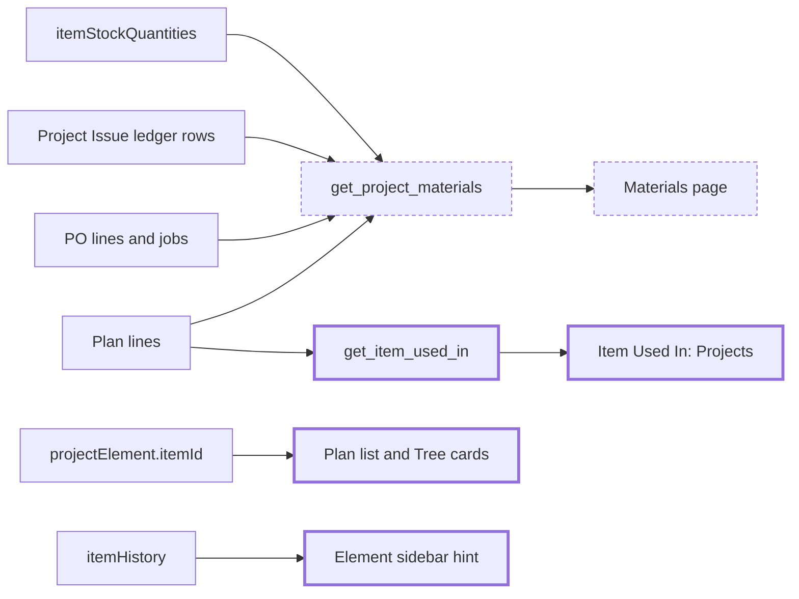

# Project Materials Page

> Status: in-progress
> Author: naveenkash
> Date: 2026-11-25
> Research: `.ai/research/2026-11-24-project-items-view.md`
> Builds on: `.ai/specs/2026-10-03-projects.md` (plan lines, part links, element history)

## TLDR

A project has no page that lists its items. This spec adds a read-only **Materials** page to the project. One row is one plan line (`projectElementMaterial`) or one unplanned item on an element. Each row shows the quantities required, ordered, received, issued and remaining. It shows the stored status of its element, PO and job, and links to each of them. One new RPC, `get_project_materials`, reads every source in one call. The spec also does 3 smaller changes:
1. The item's Used In tab gets a **Projects** group.
2. The Plan list and the Tree cards show the part linked to each element.
3. The element sidebar shows the past-average hint that `getProjectElementPage` already loads.

## Overview diagram



## Problem Statement

Carbon stores every link between an item and a project, but no page joins them:

| Link | Where Carbon shows it today |
|---|---|
| Plan line (`projectElementMaterial`) | The element page, one element at a time |
| PO line or job with the project's charge number | The element page, one element at a time |
| Issue to the project (`projectLedger`) | The Costs drill-down, one element subtree, with no total per item |
| Project stock (`itemStockQuantities.projectId`) | The Stock page, on-hand quantity only |
| Part on an element (`projectElement.itemId`) | The element sidebar only. The Plan list and the Tree cards do not show it. |
| Item → projects | Nowhere. The Used In tab has no projects group. |

Examples of questions that a user cannot answer today:
1. A buyer asks "which parts of project ABC are not ordered yet?" The buyer must open each element.
2. A store clerk asks "what is still to issue on project ABC?" No list shows it.
3. An engineer asks "which projects use part P-100?" The part page does not say.

## Proposed Solution

### 1. The Materials page

**Route:** `apps/erp/app/routes/x+/project+/$projectId.materials.tsx`. The loader calls the `getProjectMaterials` operation once.

**Sidebar:** a top-level **Materials** link after **Plan** in `useProjectNavigation.tsx`. It always shows. A project with no material rows shows the empty state.

**Rows.** The RPC returns 2 kinds of row:

| Kind | One row is |
|---|---|
| Plan row | One plan line (`projectElementMaterial`) |
| Unplanned row | One element and item pair with no plan line that has an issue, a PO line or a job |

An unplanned row combines 3 sources for one element and item pair:
1. `projectLedger` rows with `documentType` = `'Project Issue'` and no plan line for that element and item.
2. `purchaseOrderLine` rows with the project's `projectId` that no plan line links (`projectElementMaterial.purchaseOrderLineId`).
3. `job` rows with the project's `projectId` that no plan line links (`projectElementMaterial.jobId`).

A PO line or a job that no plan line of the company links always goes into an unplanned row. So an unplanned row can sit beside a plan row of the same element and item. These sources make no row:
- a PO line or a job that a plan line of another project links (it is that plan line's supply);
- an outside processing PO (it is the job's supply, not the item's);
- a Rejected PO line that received nothing, and a Cancelled job that made nothing.

An issue goes into an unplanned row for the part that no plan line of its element and item shows: `post-project-issue` raises the oldest plan line of the element and item, so the ledger's issued quantity less those lines' `quantityIssued` had no plan line. This covers an element with no plan line, and an issue posted before its plan line was added.

If a PO line or a job has no element (`projectElementId` is NULL), its unplanned row has no element. The page shows it under the group **Project (no element)**.

**Columns:**

| Column | Plan row | Unplanned row |
|---|---|---|
| Item | `projectElementMaterial.itemId` | the item of the pair |
| Element | the element's `readableId`, name and state (`StateIcon`); a link to the element page | the same, or "Project (no element)" |
| Method | `methodType` | blank |
| Required | `quantity` | 0 |
| Ordered | the linked PO line's or job's ordered quantity (see below) | the sum over the pair's PO lines and jobs |
| Received | the linked PO line's `quantityReceived` × `conversionFactor`, or the linked job's `quantityComplete` | the sum over the pair's PO lines and jobs |
| Issued | `quantityIssued` + the consumed supply (see below) | the net `Project Issue` quantity + the consumed supply |
| Remaining | max(0, Required − Issued) | blank |
| Required date | `requiredDate`, else the element start date, else the project start date | blank |
| Supply | a link to the PO or the job, with its supply status (see below) | a link to each PO and job of the pair, each with its supply status |
| Issue status | Not issued, Partly issued or Issued (see below) | Unplanned |

**Ordered quantity of a PO line.** The RPC uses the rule of `openProjectMaterialLines`:
- If the PO line is `receivedComplete`, or its PO is Closed or Rejected, Ordered = `quantityReceived` × `conversionFactor`.
- Else Ordered = the greater of `purchaseQuantity` and `quantityReceived`, × `conversionFactor`.

**Ordered quantity of a job.** If the job is Completed, Closed or Cancelled, Ordered = its `quantityComplete`. Else Ordered = its `quantity`. A job in one of these 3 statuses makes no more parts.

**Consumed supply.** 2 kinds of supply go into the project with no issue. `post-project-issue` does not raise `quantityIssued` for them. So the page adds them to Issued:
1. A PO line that `purchase_order_line_consumed_by_project` returns true for: its `quantityReceived` × `conversionFactor`.
2. A job with `consumeToProject` = true: its `quantityComplete`.

A PO line or a job that goes to project stock adds nothing. Its later issue raises `quantityIssued`, as today.

**Issues that write no ledger row.** A Statistical charge writes no `projectLedger` row. So the RPC also reads the `itemLedger` rows with `documentType` = `'Project Issue'` and `documentId` = the project. What they issued, less the plan lines' `quantityIssued` and the ledger's unplanned issues, is an Unplanned row with no element. The item ledger does not record the element, so the row sits under **Project (no element)**.

**Project Issue quantity.** One issue writes 1 to 3 `projectLedger` rows with `documentType` = `'Project Issue'`:

| Case | Rows |
|---|---|
| Normal issue | 1 ordinary row, +q |
| Charge at receipt issue | A relocation pair (`relocatesReceiptCharge`): project side +c, inventory side −c. Then an ordinary row +(q − c) if the shelf held fewer than q charged units. |
| A return | The same rows with the opposite signs |

The RPC sums every `'Project Issue'` row except the inventory side of a relocation pair. The inventory side is the row whose `journalLine` posts to the company's `rawMaterialsAccount` or `finishedGoodsAccount` (`accountDefault`). This is the rule of `project_receipt_charge_quantities` (`20261023011138`) and `onInventoryAccount` (`project-posting.ts`). Example: an issue of 5 with 3 charged units writes +3, −3 and +2. The RPC counts +3 and +2, so Issued = 5.

**Status.** The page invents no status label. It shows the stored state of the real records, in 3 places:

| Where | What it shows | Source |
|---|---|---|
| Element cell | The element's state, for example In Progress or Cancelled | `projectElement.stateId` → `projectState` (name, group, color) |
| Supply cell | The linked PO's status, for example To Receive or Closed | `purchaseOrder.status` |
| Supply cell | The linked job's status, for example In Progress or Completed | `job.status` |
| Supply cell | **No supply**, if a Purchase to Order or Make to Order line links no PO line and no job | no linked record |
| Issue status | Not issued, Partly issued or Issued | the posted issues and consumed supply (Issued) against Required |

The Supply cell of a Pull from Inventory line is empty. The line takes stock, so it has no supply document.

**Issue status.** The RPC sets it from the posted quantities:

| Condition | Issue status |
|---|---|
| Unplanned row | Unplanned |
| Issued ≥ Required | Issued |
| Issued > 0 | Partly issued |
| Issued = 0 | Not issued |

The RPC computes the issue status in SQL. The TypeScript side reads it and never computes it again (`.ai/lessons.md`: take status from the view the list reads).

**Project stock columns.** If `project.projectStock` is true, the page adds 2 columns per row, read by item. Every row then has both numbers, 0 when nothing is on hand, so the columns do not depend on the filter:
1. **Project on hand**: the sum of `itemStockQuantities.quantityOnHand` where `projectId` = the project, over all locations.
2. **Unassigned at project location**: the sum of `itemStockQuantities.quantityOnHand` where `projectId` = `''`, at the project's location (`project.locationId`).

**Toolbar.** The toolbar has one row, like the Pegging page:
1. A search box (`?search=`). It matches the item's readable id and name, and the element's readable id and name.
2. One **Filter** button, as on the Plan page (`ElementsHeader`). It holds 2 filters:
   - **Supply status** (multi-select): No supply, the PO statuses and the job statuses.
   - **Issue status** (multi-select): Not issued, Partly issued, Issued, Unplanned.
   The filters live in `?filter=` (for example `filter=supplyStatus:eq:No supply`). When a filter is set, its chips replace the button.
3. A **Group by** select (`?groupBy=`): **Element** (the default) or **Item**.

All of them live in the URL, so a link reopens the same view.

**Column order.** Item or Element, Method, Issue status, Supply, Required, Ordered, Received, Issued, Remaining, Required date, then the stock columns. The status columns come first so that they show without a horizontal scroll at 1440 px. The table scrolls on its own; the toolbar does not move.

**Grouping.** The page hides the column that the group row already names.
- **Element:** one group per element, in element number order (`projectElement.sequence`). The unplanned rows with no element come last, under **Project (no element)**. The Element column is hidden.
- **Item:** one group per item. The group header shows the totals of Required, Ordered, Received, Issued and Remaining, next to the item's name. If the rows of a group use more than one unit of measure, the header shows no totals. The Item column is hidden.

**Size.** The page is a single-load list (`.claude/rules/table-infinite-scroll.md`). The RPC returns at most 1,001 rows. If it returns 1,001, the page shows the first 1,000 and the truncated notice.

### 2. The Projects group on the item's Used In tab

`get_item_used_in` gets a new key, `projectMaterials`. It has one entry per plan line of the item, newest first, at most 100, with no status filter, like `jobMaterials`. Each entry has:
- `id`: the plan line id
- `documentReadableId`: the element's `readableId` (for example `ABC-12`)
- `documentId`: the project id
- `documentParentId`: the element id (the field `UsedInNode` children already have)

The group's name is **Projects**. It needs the `projects.projects` page. A click opens the element page (`path.to.projectElement`). The group goes into each tree that lists `jobMaterials`:
- `routes/x+/part+/$itemId.tsx` (both trees)
- `routes/x+/material+/$itemId.tsx`
- `routes/x+/consumable+/$itemId.tsx`
- `routes/x+/tool+/$itemId.tsx` (both trees)
- `modules/items/ui/ChangeNotice/ImpactPanel.tsx`

### 3. The linked part on the Plan list and Tree cards

`PROJECT_ELEMENT_LIST_COLUMNS` already selects `itemId`. The List layout (`ElementList.tsx`) and the Tree card (`graph/ElementCardNode.tsx`) show the part's readable id when `itemId` is set. They read the item from the items store (`useItems`), so the page makes no new query. The Graph layout's box nodes do not change.

### 4. The past-average hint in the element sidebar

`getProjectElementPage` already returns `itemHistory` from `get_element_history_by_item`. The element sidebar (`ElementSidebar.tsx`) shows one line under **Hours estimate**, for example "Average on this part: 5.8 h, $1,240 material over 12 elements". The average includes this element, because `get_element_history_by_item` does not leave it out. It shows only when the element links a part and `elementCount` > 0. The hint is text only and has no action.

### Design Decisions

| Decision | Choice | Rationale |
|---|---|---|
| Rows (Q1) | Plan rows, plus unplanned rows from issues, PO lines and jobs with no plan line | User answer. Business Central and Acumatica show unplanned use. "+ Add Job" and a hand-made PO line create no plan line, so without them a buyer misses supply. |
| Unplanned row key | One row per element and item pair | One row per source document would split one item into many rows. The Supply cell lists each document. |
| Name and place (Q2) | **Materials**, top level after Plan, always shown | User answer. The plan-line modal and the ledger cost type both say Material. It is a planning view, not a cost view. |
| Row actions (Q3) | Read-only. Links to the element and to the supply. | User answer. The page needs no plan-lock or change-request logic. The element page keeps Issue, Create PO line, Create Job and Edit. |
| Money (Q4) | Quantities only | User answer. The Costs page owns money, so two pages cannot show different material totals. |
| Status (Q8) | Show the stored state of the real records: the element state, the PO status and the job status. Add only an issue status (Not issued, Partly issued, Issued, Unplanned) from the posted quantities. | User answer. It replaces the 7 derived labels of Q5 and Q7. The page always agrees with the PO, job and element pages, and no new writer can make it drift. SAP also shows the documents and quantities, not one invented status. |
| Stored status column | No. `projectElementMaterial` gets no status column. | Discussed under Q8. About 6 postings would have to update it, each with a guarded status write, and a missed writer makes it drift. |
| Finished supply | A Closed or Rejected PO counts only what it received. A Completed, Closed or Cancelled job counts only what it completed. | The PO rule is the `covered` rule of `openProjectMaterialLines`, so the page and MRP agree on what a PO line still brings. The job rule applies the same idea to jobs. |
| Issued (Q5, re-asked) | `quantityIssued` + consumed supply | User answer. `post-project-issue` is the only writer of `quantityIssued`. A consumed PO line or a `consumeToProject` job never raises it. |
| Remaining | max(0, Required − Issued) | The page answers "what must still reach the element". It is not MRP's open demand (`openProjectMaterialLines`), which also subtracts consumed supply that is on order. The column name **Remaining** matches `remainingMaterialQuantity` (`projects.models.ts`). |
| Used In content | The Projects group lists plan lines only, not project stock | Every Used In group lists records that reference the item. Stock is not a reference. Inventory Quantities already filters stock by project (`?project=`). |
| Small fixes (Q6) | Include the Plan part link and the sidebar hint | User answer. |
| Read path | One RPC, `get_project_materials(project_id, company_id)`, `LANGUAGE sql`, `STABLE`, `SECURITY INVOKER` | The page joins 5 sources and aggregates them. `.claude/rules/database-patterns.md` puts real aggregation in a view or an RPC. One call avoids N+1 reads. |
| Whose access (Q9) | The operation checks `"projects.projects": "View"`. Then the building block calls the RPC through the system handle (`ctx.asSystem.pg`). | User answer. It copies `getProjectStockOnHand`. The RPC reads `purchaseOrderLine`, `job`, `itemLedger` and `journalLine`, which other modules guard. Under the user's RLS, a Projects-only user would get wrong Issued numbers. The page shows no prices or costs. |
| Service shape | Building block `getProjectMaterials(db, { companyId, projectId })` in `projects.service.ts`; operation `getProjectMaterials` in `projects.server.ts`, tagged `@mcp read` | The precedent is `getProjectStockOnHand`: Kysely, the system handle, `@mcp read`. |
| Permission | `"projects.projects": "View"` on the loader and on the operation | The same as the Stock and Pegging pages. |
| Multi-tenancy (heuristic 1) | No new table. The RPC filters every source by `company_id` and joins on `companyId`. The operation passes `ctx.company.id`, never a client value. | The system handle skips RLS, so the `company_id` filter is the only tenant guard on the page's path. |
| RLS (heuristic 3) | No new table, no new policy. The RPC stays `SECURITY INVOKER`. | A direct PostgREST call runs under the caller's RLS, so it cannot read other companies' rows. |
| Forms (heuristic 5) | N/A | The page has no form. The toolbar writes URL params only. |
| Module layout (heuristic 6) | New code goes into `projects.service.ts`, `projects.server.ts` and `ui/Materials/ProjectMaterials.tsx`. No barrel. | `.claude/rules/module-files.md`. |
| Backward compatibility (heuristic 7) | `get_item_used_in` adds one key. No key changes. | The `ItemUsedIn` type and `NOT_USED` gain `projectMaterials: []`. Old readers ignore the key. |
| Units | Show each row in its own unit. Total a group by item only when all its rows share one unit. | A plan line stores `unitOfMeasureCode`. The ledger and the job store their own unit. A sum over different units is wrong. |

## Data Model Changes

No new table and no new column. One migration adds 2 functions:
1. A new function, `get_project_materials`.
2. A new body for `get_item_used_in`. Fork it from its newest definition (`20261005041631_item-usage-and-change-notice-lookups.sql`).

SQL sketch of the new function. The plan writes the final SQL and its tests.

```sql
CREATE OR REPLACE FUNCTION get_project_materials(project_id TEXT, company_id TEXT)
RETURNS TABLE (
  "rowKind" TEXT,                -- 'Plan' | 'Unplanned'
  "projectElementMaterialId" TEXT,
  "projectElementId" TEXT,
  "itemId" TEXT,
  "methodType" "methodType",
  "unitOfMeasureCode" TEXT,
  "quantityRequired" NUMERIC,
  "quantityOrdered" NUMERIC,
  "quantityReceived" NUMERIC,
  "quantityIssued" NUMERIC,
  "quantityRemaining" NUMERIC,
  "requiredDate" DATE,
  "elementStateName" TEXT,       -- projectState.name; NULL for "Project (no element)"
  "elementStateGroup" TEXT,      -- projectState.group
  "elementStateColor" TEXT,      -- projectState.color
  "issueStatus" TEXT,            -- Not issued | Partly issued | Issued | Unplanned
  "supplies" JSONB,              -- [{ "type": "Job" | "Purchase Order", "documentId", "readableId", "lineId",
                                 --    "status": purchaseOrder.status | job.status }]; [] = No supply
  "projectOnHand" NUMERIC,       -- NULL unless project.projectStock
  "unassignedOnHand" NUMERIC     -- NULL unless project.projectStock
)
LANGUAGE sql STABLE SECURITY INVOKER SET search_path = public AS $$
  WITH plan AS (
    -- one row per projectElementMaterial of the project,
    -- LEFT JOIN its purchaseOrderLine and its job,
    -- consumed = received when purchase_order_line_consumed_by_project(...),
    --          + quantityComplete when job.consumeToProject
  ),
  issues AS (
    -- projectLedger, documentType = 'Project Issue', jobId IS NULL,
    -- the stored row of each issue (the ordinary row, else the project side of the relocation),
    -- summed by (projectElementId, itemId)
  ),
  unplanned_supply AS (
    -- purchaseOrderLine and job rows of the project that no plan line links
  ),
  unplanned AS (
    -- issues + unplanned_supply, grouped by (projectElementId, itemId),
    -- with no plan line for the same pair
  )
  SELECT ... FROM plan
  UNION ALL
  SELECT ... FROM unplanned
  ORDER BY ...
  LIMIT 1001;
$$;
```

## API / Service Changes

| File | Change |
|---|---|
| `projects.service.ts` | New building block `getProjectMaterials(db, { companyId, projectId })`. It runs `SELECT * FROM get_project_materials(...)` through Kysely and returns the rows. Export the type `ProjectMaterialRow`. |
| `projects.server.ts` | New operation `getProjectMaterials`, `@mcp read`, permission `"projects.projects": "View"`. |
| `routes/x+/project+/$projectId.materials.tsx` | New loader and route. It logs an error the way `$projectId.stock.tsx` does. |
| `utils/path.ts` | New `path.to.projectMaterials(projectId)`. |
| `shortcuts.ts` | New `PROJECT_TAB_SHORTCUTS.materials`. Pick a free `mod+shift+` key; `m` belongs to Schedule. |
| `items.service.ts` | `ItemUsedIn`, `NOT_USED` and the hand-written key list of `getMaterialUsedIn` gain `projectMaterials`. |
| `getProjectElementPage` | No change. It already returns `itemHistory`. `ElementView` passes it on to `ElementSidebar`. |
| `ImpactPanel.tsx` | Its own `usedIn` type gains `projectMaterials`. |
| `.claude/rules/projects-system.md` | Replace the line that says the element page no longer shows the history. Add a Materials page section. |

After the migration, run `pnpm run generate:types`, then `pnpm generate:mcp`.

## Closest Sibling

The sibling is the project **Pegging** page. It is the only project page that groups rows by item, and it is a read-mostly table with links to the supply.

| This feature | Copies |
|---|---|
| `$projectId.materials.tsx` | `$projectId.pegging.tsx` and `$projectId.stock.tsx` (loader shape, error logging) |
| `ui/Materials/ProjectMaterials.tsx` | `ui/Pegging/ProjectPegging.tsx`: the toolbar row, the `Table` with group rows, the `supplyCell` links, `Empty` |
| `getProjectMaterials` (service + operation) | `getProjectStockOnHand` |
| Sidebar link | The `Plan` and `Costs` entries in `useProjectNavigation.tsx` |
| `projectMaterials` Used In group | The `jobMaterials` group |

Deviations from Pegging, each a Design Decision above:
1. The link is top level and always shown. Pegging is indented under Costs and shows only with pegs (Q2).
2. The toolbar has search, Supply status, Issue status and Group by. Pegging has As of.
3. The page has no row actions. Pegging has a Manual peg action (Q3).

## UI Changes

**Archetype:** a record sub-page with a grouped table, the same as Pegging.

| Surface | Change |
|---|---|
| Project sidebar | New **Materials** link after Plan |
| Materials page | New. Toolbar, grouped table, `Empty` state, truncated notice |
| Status badges | Reuse `PurchasingStatus` (PO), `JobStatus` (job) and `StateIcon` (element state). The Issue status uses `Status` with a new color map in `@carbon/utils`, like `PROJECT_PEG_STATE_COLOR_MAP`. |
| Item Used In (4 item routes + ImpactPanel) | New **Projects** group, with a tooltip: "Projects that have this item on their plan" |
| Plan List layout and Tree cards | The part's readable id, when the element links a part |
| Element sidebar | One hint line under Hours estimate |

Every new string goes through Lingui (`t` / `Trans`). Run `/translate` before the commit.

## Acceptance Criteria

Materials page:
- [ ] A project with 2 elements has 3 plan lines: one Pull from Inventory, one Purchase to Order with a PO line, one Make to Order with a job. The Materials page shows 3 rows under 2 element groups.
- [ ] A Purchase to Order line has quantity 10. Its PO line orders 10 and receives 4 into project stock. The row shows Ordered 10, Received 4, Issued 0, Remaining 10, the PO's stored status, and Not issued.
- [ ] A Purchase to Order line has quantity 10. Its PO line receives 10, and the project consumes them at receipt. The row shows Issued 10 and Issued.
- [ ] A Make to Order line has a `consumeToProject` job with `quantityComplete` 2 of 5. The row shows Received 2, Issued 2, the job's stored status, and Partly issued.
- [ ] A Purchase to Order line has no PO line. Its Supply cell shows No supply.
- [ ] A Pull from Inventory line has an empty Supply cell.
- [ ] A Purchase to Order line has quantity 10. Its PO line orders 10, receives 3, and its PO is then Closed. The row shows Ordered 3 and the PO's status Closed.
- [ ] Change the linked PO's status on the PO page. A reload of the Materials page shows the new status.
- [ ] A plan line on an element in a Cancelled state shows that state in its Element cell.
- [ ] Issue 3 of an item to an element that has no plan line for it. The page shows one Unplanned row with Required 0 and Issued 3.
- [ ] Return 1 of the same issue. The Unplanned row shows Issued 2.
- [ ] On a Charge at receipt project, one issue of 3 with 3 charged units shows Issued 3, not 6 or 0.
- [ ] On a Charge at receipt project, an issue of 5 with 3 charged units shows Issued 5.
- [ ] A job made with "+ Add Job" on an element shows as an Unplanned row with the job in Supply.
- [ ] A PO line with the project's charge number and no element shows under **Project (no element)**.
- [ ] A job that consumes 5 components to the project adds no Unplanned rows for those components.
- [ ] Group by Item totals 2 plan lines of one item on 2 elements, in one unit.
- [ ] The Supply status filter "No supply" hides every row that has a PO or a job. A reload keeps the filter.
- [ ] The Issue status filter "Not issued" hides every row with an issue.
- [ ] With `projectStock` false, the page has no stock columns. With it true, both stock columns show.
- [ ] A user without `projects.projects` View gets the standard unauthorized response.
- [ ] The operation for company A, with a project id of company B, returns 0 rows.
- [ ] `get_project_materials` called as `anon` returns 0 rows.

Used In:
- [ ] A part on plan lines of 2 projects shows a **Projects** group with 2 entries. Each entry opens its element page.
- [ ] A user without the `projects.projects` page does not see the group.

Plan and sidebar:
- [ ] An element that links part P-100 shows `P-100` in the List layout and on its Tree card.
- [ ] An element that links a part with past history shows the hint under Hours estimate. An element with no part shows no hint.

## Risks

| Risk | Severity | Mitigation |
|---|---|---|
| The Project Issue count picks the wrong side of a relocation pair and shows 0 or double | High | Database tests for 3 cases: a normal issue, a pure relocation, and a mixed issue (+3, −3, +2), each with a return |
| Job component rows leak into Unplanned rows | Med | Job component rows use `documentType` = `'Job Consumption'`. The RPC reads only `'Project Issue'` rows. Add an acceptance test (above). |
| The system handle shows a row of another company | High | The RPC filters every table by `company_id`. A database test calls it with company A and a project of company B. |
| A PO line linked to a plan line also counts as unplanned | Med | The unplanned supply excludes every id in `projectElementMaterial.purchaseOrderLineId` and `jobId`. Add a database test. |
| Issued differs from the element page's Estimated card, which reads `quantityIssued` only | Low | The difference is only the consumed supply. Name it in the column tooltip. |
| A second definition of "consumed by the project" | Med | Call `purchase_order_line_consumed_by_project`. Do not copy its body. |
| A new embed or FK breaks bare embeds (TS2589) | Low | The page reads an RPC. It adds no FK. |
| The `get_item_used_in` fork drops a change made after `20261005041631` | Med | Fork the newest definition on main at the time of the migration (`.ai/lessons.md`). |

## Open Questions

- [x] Q1. Which rows does the page show? — **Answer:** Plan lines, plus Unplanned rows. An Unplanned row holds the issues, PO lines and jobs of one element and item pair that no plan line covers.
- [x] Q2. What is the page's name and place? — **Answer:** **Materials**, a top-level sidebar link after Plan, always shown.
- [x] Q3. Can the user act on a row? — **Answer:** No. The page is read-only. The Element and Supply cells link out.
- [x] Q4. Does the page show money? — **Answer:** No. Quantities only. The Costs page owns money.
- [x] Q5. Which statuses does a row have? — **Answer:** To order, On order, To issue, Partly issued, Issued, Cancelled and Unplanned, derived from the quantities. **Superseded by Q8.**
- [x] Q5 (re-asked). What counts as Issued? — **Answer:** `quantityIssued` + the received quantity of a linked PO line consumed by the project + the completed quantity of a linked `consumeToProject` job. This matches MRP's treatment of consumed supply.
- [x] Q6. Does this spec include the 2 small fixes? — **Answer:** Yes, both: the linked part on the Plan list and Tree cards, and the past-average hint in the element sidebar.
- [x] Q7 (found while writing). How does a partly ordered plan line show? — **Answer:** Rule 5 becomes "Ordered < Required → To order". A line that needs 10 with 4 ordered shows To order. **Superseded by Q8.**
- [x] Q8 (user review). Should the status come from the real records instead of derived labels? — **Answer:** Yes. The page shows the stored element state, PO status and job status, plus an issue status (Not issued, Partly issued, Issued, Unplanned). No stored status column.
- [x] Q9 (found while planning). Whose access does the page read with? — **Answer:** The operation checks Projects View, then calls the RPC through the system handle, as the Stock page does. A Projects-only user sees PO and job numbers and statuses on this page, and no prices.

## Changelog

- 2026-11-25: Created. The user answered Q1 to Q6 before the spec was written. Q7 came up while writing, and the user answered it before the spec became final.
- 2026-11-25: Q8. The status now shows the real records (element state, PO status, job status) and an issue status. It replaces the 7 derived labels of Q5 and Q7. The toolbar has a Supply status filter and an Issue status filter.
- 2026-11-25: Q9. The page reads through the system handle after the Projects View check. The Project Issue count now sums every row except the inventory side of a relocation pair. The part route's 2 Used In trees both get the group.
- 2026-11-25: Planning fixes. The Element cell drops the WBS code, because the RPC cannot compute derived codes. Element groups sort by `sequence`. A Used In entry carries the element id in `documentParentId`. An unlinked PO line or job always makes an unplanned row.
- 2026-11-25: Implementation. The 2 status filters sit in one Filter button (`?filter=`), as on the Plan page. The page hides the column its group row names, and the status columns come before the quantities, so that they show at 1440 px (found in the browser test). The sidebar hint pluralises the element count.
- 2026-11-25: Review fixes. An Unplanned row shows No supply never: only a Purchase to Order or Make to Order line does. The stock columns follow the project. An issue a Statistical charge records only in the item ledger shows as an Unplanned row with no element. A PO line or job that another project's plan line links, an outside processing PO, and a Rejected or Cancelled supply that brought nothing make no row. An issue posted before its plan line existed stays an Unplanned row of its element. The page says when the read failed. The Supply cell shows the status before the number, and the hint reads "Average on this part".
