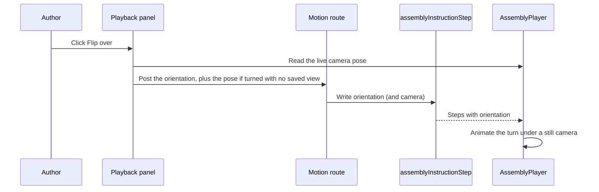

# Per-step build orientation

> Status: implemented (built and browser-tested)
> Author: Claude (feature pipeline, autonomous mode)
> Date: 2026-10-09

## TLDR

An author can turn the whole build on a step of an assembly instruction. For
example, they can flip the build to fit parts on its underside. The
orientation stays on the later steps of the same build until a step sets a new
one. Playback shows the turn as an animation, so the operator sees the build
turn over the way it turns over at the bench. The author sets it with five
turn buttons in a new Orientation row of the step's Playback panel: Flip over
turns the build 180°, and the other four turn it 90°. The ERP editor and the
MES player show the same turn.

## Overview diagram



## Problem Statement

The author can show a step from any camera angle, and can turn the part that
goes in. The author cannot turn the build that the part goes into.

| Tool today | What it does | What it cannot do |
|------------|--------------|-------------------|
| Camera, "Use Current View" | Looks at the build from any side, below included | Turn the build. `OrbitControls` keeps `camera.up` fixed (`AssemblyViewer.tsx:81`), so the build always stands upright on screen |
| Waypoint rotation | Turns the incoming part along its path | Turn the base that the part goes into |

So a step that fits a part on the underside shows the build from below,
hanging over the viewer. At the bench, the person flips the build and fits the
part from above. The two components cannot be shown together at the angle the
person works at.

Example: a demo assembly has a base plate. Step 1 fits a bracket on top. Step 2
fits a cover under the plate. Today step 2 shows the plate from below. With
this feature, step 2 flips the plate over, and the cover drops in from above.

## Proposed Solution

1. Add a nullable `orientation` column to `assemblyInstructionStep`. It holds
   a quaternion `[x, y, z, w]`. Null means "same as the previous step in this
   build".
2. Add a pure module `packages/viewer/src/orientation.ts`. It resolves the
   orientation of each step, and it applies one turn.
3. Make the player show a step's orientation as a camera frame. The player
   animates the turn when the orientation changes between steps.
4. Add an Orientation row to the step's Playback panel in the ERP. It has five
   turn buttons and a Reset button.
5. Pass the column to the MES player.

### How the player shows an orientation

An orientation `Q` turns the model frame into the bench frame. The bench frame
is Z-up, like the model. The player does not turn the model. It moves the
camera instead:

- `camera.up` becomes `Q⁻¹ · (0, 0, 1)`.
- When the orientation changes from `Q0` to `Q1`, the player turns the camera
  about the build's center: the center of the whole-assembly bounds. It moves
  the camera through the frames `Q(t) = slerp(Q0, Q1, t)` over about 0.9
  seconds. On each frame it applies `Q(t)⁻¹ · Q(t-1)` to the camera position,
  to the controls target and to `camera.up`.
- The pivot is the build's center, not the controls target. A turn about the
  target swung an off-center build round in an arc.
- The camera stays still in the bench frame during the turn. So on screen the
  build turns in place, and the camera does not move.
- A turn does not re-frame the step. The framing key leaves out the
  orientation, so the camera stays where the turn left it.
- When the active step moves to another build (the main build to a
  sub-assembly, or back), the player snaps the camera frame to the new
  build's orientation with no turn animation. The two builds are on different
  benches, so nobody turns one into the other.
- When the scene unmounts, the player clears its turn state and puts
  `camera.up` back to Z-up. The camera outlives a remounted scene, so the next
  scene starts from an upright frame.

Why the camera and not the model: the motion code works in world space.
`worldPoseOf` and `nodeTracks` (`motion.ts`), `seatedBoundsCenter`, the path
editor and the box select all read `matrixWorld` or the graph bounds. If the
player turned a root node, each of them would need a frame change. A turned
camera gives the same picture, because the key light follows the camera
(`HeadLight`, `AssemblyViewer.tsx`).

The motion data and the plan hint stay in the model frame. A saved view uses the bench frame:

| Data | Frame | Effect of an orientation |
|------|-------|--------------------------|
| Step motion and waypoints | Model | None. The path turns with the build on screen |
| Saved view (`CameraPose`) | Bench | The view stays where the viewer stands. A turn of the step turns the build under it |
| Plan hint (`direction`) | Model | Used only on an upright build |
| Live framing on a turned build with no saved view | Bench | The camera keeps its direction on the bench. Only the target and the distance follow the step. It does not re-frame from above |
| Live AABB framing on an upright build | Model | The candidate rings go around the step's `up`, not `camera.up` |

### Resolving each step's orientation

`resolveOrientations(steps)` walks the steps in play order. It keeps one
current orientation for each build:

1. Find the build of the step with `worldOf(steps, stepId)`. The main build is
   `null`. A sub-assembly member gets its header id.
2. If the step has an `orientation`, make it the current orientation of that
   build.
3. Give the step the current orientation of its build, with the id of the step
   that set it.

Each build starts with no turn (the identity quaternion). A person builds a
sub-assembly on its own bench, so it starts upright. A finished sub-assembly joins
the main build in the main build's orientation.

### Turning from the Playback panel

Each button turns the build about an axis in the bench frame:

| Button | Axis | Angle |
|--------|------|-------|
| Flip over | the square axis nearest `Z × h` | 180° |
| Tip toward you | the square axis nearest `Z × h` | +90° |
| Tip away from you | the square axis nearest `Z × h` | −90° |
| Spin left | Z (bench up) | −90° |
| Spin right | Z (bench up) | +90° |

`h` is the horizontal direction from the target to the camera, in the bench
frame. "Tip toward you" moves the top of the build toward the viewer. A
square axis (±X or ±Y) keeps every turn a clean right angle from a slanted
view. If the camera looks straight down, `h` is the CAD front `(0, -1, 0)`.

`turnOrientation(current, turn, pose)` returns `R · current`. Then it snaps
the result to the nearest of the 24 right-angle orientations, so repeated
turns do not drift. If the result equals the orientation the step gets from
the previous step, the panel saves `null`. So a turn and its opposite turn
leave the orientation as it was.

The same post can also save a view. `useBuildOrientation` (ERP) applies one
rule:

1. If the turn leaves the step turned (the saved orientation is not `null`),
   and the step has no saved view, post the live camera pose as `camera`.
2. Otherwise, post the orientation only.

A plan hint (`{ source: "plan" }`) does not count as a saved view. Only a
manual pose (`position`, `target`, no `source`) counts. `isSavedView`
(`@carbon/viewer`) makes this check for the turn rule and for the Camera row.
The pinned view makes playback land on what the author saw. A turn back to the inherited
orientation keeps the pinned view. Reset on the Orientation row posts
`orientation: null` only. "Clear" on the Camera row returns the step to
automatic framing.

### Design Decisions

| Decision | Choice | Rationale |
|----------|--------|-----------|
| Turn controls | Five buttons in screen terms: Flip over (180°), Tip toward you, Tip away from you, Spin left, Spin right (90° each). They sit on their own line under the row | The user chose screen terms. A UX review added Flip over, the most common need, and plain names |
| Tip axis | The bench axis that runs most nearly left-right on screen | A slanted view gave a slanted axis, and the snap then jumped to an unexpected pose |
| Camera after a turn | Stays still; the turn does not re-frame the step | Re-framing to the model-frame plan hint swung the camera after the build and undid the turn on screen |
| Turn pivot | The center of the whole-assembly bounds | A turn about the controls target swung an off-center build round in an arc |
| View after a turn | A turn that leaves the step turned saves the live view, unless the step has a saved view | Playback then lands on what the author saw. A saved view is never overwritten |
| Turned step with no saved view | Keeps the camera's direction on the bench | A re-aim by geometry undid a spin and showed a pose the author never chose |
| Move between builds | Snap to the new build's orientation, no animation | The main build and a sub-assembly are on different benches |
| Row text | The pose: Upright, Upside down, On its side, with "from step N" when inherited | "Turned" did not say how the build sits |
| Chain per build | Main build and each sub-assembly have their own chain. A sub-assembly starts upright | The user chose it. The player builds a sub-assembly on its own (`subassembly.ts`) |
| Storage | New nullable JSONB column `orientation` | The user chose it. `warnings` holds planner output, and a re-plan rewrites it |
| Absolute or relative value | Absolute (model to bench) | A later step stays correct when an earlier step changes. Reset is a `null` write |
| Mechanism | Camera frame (`camera.up` and offset), not a turned root node | The motion, editor and box-select code all work in world space. The picture is the same |
| Turn animation | Slerp over 0.9 s with ease-in-out, then the step's framing | The operator sees the build turn over, as at the bench |
| Free camera mode | The turn still plays | The orientation is a fact of the step, not a framing choice |
| Viewcube | Shows the model axes, so "Bottom" can be at the top. A face click looks at that face and keeps the build turned | This matches a CAD viewer. See Risks for the `camera.up` reset |
| Optimistic display | The route reads the pending value from the fetcher's `formData` | No `useState` copy of loader data (`coding-conventions.md`) |
| Double clicks | The turn buttons are disabled while the save is in flight | Two posts in flight can land in the wrong order |
| Multi-tenancy (heuristic 1) | No new table. The column is on a table that already has `companyId` | — |
| Service shape (heuristic 2) | `updateAssemblyStepMotion` takes one more optional field. It returns `{ data, error }` as before | — |
| Atomic path save | `updateAssemblyStepMotion` takes the Kysely handle and writes each patch as one `UPDATE`. A path edit and a Reset read `motion` and `warnings` from the row they write | A read and a separate write let a drag save and a Reset that reach the server together lose `warnings.plannedMotion`. Reset then put back the wrong path |
| Camera row value | "Saved view" only for a manual view. A plan hint reads "Automatic" and has no Clear | A plan hint only aims the automatic framing. Clear on it would delete the planner's view direction |
| RLS (heuristic 3) | No change. The existing `assemblyInstructionStep` policies cover the column | — |
| Permissions (heuristic 4) | The motion route keeps `update: "production"` | — |
| Form pattern (heuristic 5) | The route validates with `assemblyInstructionStepMotionValidator` | The viewer buttons post with a fetcher, like the camera buttons |
| Module layout (heuristic 6) | Validator in `production.models.ts`, service in `production.service.ts` | — |
| Backward compatibility (heuristic 7) | The new column is nullable. Old steps play as before | Version copy carries the column through `...rest` (`copyAssemblyInstructionAsVersion`) |

## Data Model Changes

One migration, `assembly-step-orientation`:

```sql
-- The build's orientation from this step on: a unit quaternion [x, y, z, w]
-- that turns the model frame into the bench frame. NULL = same as the
-- previous step in the same build (a sub-assembly starts upright).
ALTER TABLE "assemblyInstructionStep"
  ADD COLUMN IF NOT EXISTS "orientation" JSONB;
```

No new table, so no RLS or index change. Run `pnpm db:migrate`, then
`pnpm run generate:types`.

The demo datasets build their INSERTs from `information_schema`
(`datasets/sql.ts`). A nullable column needs no dataset change.

## API / Service Changes

| Place | Change |
|-------|--------|
| `packages/viewer/src/types.ts` | `AssemblyStep.orientation?: Quat \| null` |
| `packages/viewer/src/orientation.ts` (new) | `BuildTurn`, `IDENTITY_ORIENTATION`, `resolveOrientations`, `upForOrientation`, `turnOrientation`, `snapOrientation`, `sameOrientation`, `isOrientation` |
| `packages/viewer/src/index.ts` | Export the new module |
| `packages/viewer/src/AssemblyPlayer.tsx` | Resolve the active step's orientation. Animate the turn in the camera `useFrame`. Use the step's `up` in the framing effect |
| `production.models.ts` | `orientationSchema` (unit quaternion). `assemblyInstructionStepMotionValidator` gets `orientation` |
| `production.service.ts` | `updateAssemblyStepMotion` writes `orientation` when the caller sends it, in the same single `UPDATE` as the motion and camera patch. `toViewerStep` maps it |
| `$id.steps.motion.$stepId.tsx` | Pass `orientation` to the service. Pass `getDatabaseClient()` as the service's `db` |
| `ui/Assemblies/useBuildOrientation.ts` | The orientation fetcher, the pending orientation on the viewer steps, `onTurn`, `onReset`, `isSaving` |
| `ui/Assemblies/assembly-step-patch.ts` | `stepPatchFormData`, the one form body for the motion route (motion, camera, orientation, reset) |
| `ui/Assemblies/AssemblyOrientationRow.tsx` | The Orientation row: pose text, five turn buttons, Reset |
| `$id.tsx` (assembly route) | Builds the viewer steps and passes them through `useBuildOrientation` |
| `apps/mes/app/services/operations.service.ts` | Select `orientation` |
| `apps/mes/app/components/AssemblyView.tsx` | Map `orientation` through `isOrientation` |

The route posts `orientation` as JSON. The string `null` clears the value.

## UI Changes

The step's Playback panel gets an Orientation row under the Camera row. It
uses `PlaybackRow` and `LabelWithHelp` with a new glossary term
`assembly-build-orientation`.

| State | Value text | Buttons |
|-------|------------|---------|
| The build is upright | Upright | 5 turn buttons (Reset when this step set it) |
| The build is upside down | Upside down, or "Upside down, from step {number}" when inherited | 5 turn buttons (Reset when this step set it) |
| The build lies on a side | On its side, or "On its side, from step {number}" when inherited | 5 turn buttons (Reset when this step set it) |
| Instruction is not a Draft | The value text only | None |

The turn buttons are icon buttons on their own line, with a tooltip each:
Flip over, Tip toward you, Tip away from you, Spin left, Spin right. Reset
saves `null`, so the step takes the orientation of the previous step. The row
does not show on a sub-assembly header panel.

After a turn that leaves a step with no saved view turned, the Camera row
reads "Saved view".

The Camera row reads "Saved view" only for a manual view. A step with a plan
hint reads "Automatic", like a step with no camera, and the row offers no
Clear for it. "Use Current View" replaces the plan hint with a manual view.

All text uses Lingui. The non-English translations stay empty for the user to
fill.

## Acceptance Criteria

- [ ] On a Draft, the author selects a step with no saved view and clicks Flip over. The build turns over in place, the camera stays still, and the row reads "Upside down". The Camera row reads "Saved view".
- [ ] After a reload, the step still shows the build turned over.
- [ ] The next step of the same build reads "Upside down, from step {number}" and shows the build turned over.
- [ ] Reset on the turning step gives it the orientation of the step before it. Reset does not change the camera.
- [ ] Spin left, then Spin right, saves `null` for the orientation, and the Orientation row reads as before. The Camera row keeps the view that Spin left saved. "Clear" returns it to automatic.
- [ ] Playback from step 1 shows the turn as an animation at the turning step. The step's part then goes in along its path, turned with the build.
- [ ] A step with a saved view keeps that view after a turn, and the build turns under it.
- [ ] A later step of a turned build with no saved view keeps the camera's direction on the bench. It does not re-frame from above.
- [ ] Moving from a turned main-build step to a sub-assembly step shows the sub-assembly upright at once, with no turn animation.
- [ ] A sub-assembly member step starts upright, even after a main-build step that flips the build.
- [ ] A turn on a sub-assembly member does not change the main-build steps.
- [ ] New Version copies the orientation of every step.
- [ ] The MES player shows the same orientation for the step.
- [ ] `pnpm --filter @carbon/viewer test` passes, with tests for `resolveOrientations`, `turnOrientation` and `snapOrientation`.
- [ ] The viewer and ERP typecheck pass. Biome passes.

## Risks

| Risk | Severity | Mitigation |
|------|----------|------------|
| The viewcube resets `camera.up` to Z when the author clicks a face (drei `GizmoHelper.js:73`) | Med | Confirmed in the browser. The player's frame loop sets `camera.up` back to the build's up after the tween |
| The hemisphere and back fill lights stay fixed in the model frame, so the turned build has slightly different shading | Low | The key light follows the camera. Accept it |
| An orbit during the turn fights the turn animation | Low | The player stops the turn when the user grabs the controls, as it does for the framing transition, and snaps to the target orientation |
| A turn while the camera looks straight down has no horizontal direction | Low | `turnOrientation` uses the CAD front `(0, -1, 0)` |
| A saved view taken before a turn now looks at the other side of the model | Low | This is the intent: the viewer stays put and the build turns. The author can take the view again |

## Open Questions

> HARD STOP: Do not proceed with implementation until these are answered.

- [x] Which controls turn the build? — **Answer:** buttons in screen terms. The user chose this. A later UX review renamed them and added Flip over: Flip over, Tip toward you, Tip away from you, Spin left, Spin right.
- [x] Does a sub-assembly share the main build's orientation? — **Answer:** no. Each build has its own chain, and a sub-assembly starts upright. The user chose this.
- [x] Where does the orientation live? — **Answer:** a new nullable `orientation` JSONB column. The user chose this.
- [x] Does the player turn the model or the camera? — **Autonomous:** the camera. The motion, editor and box-select code all work in world space (`motion.ts` `worldPoseOf`, `nodeTracks`; `seatedBoundsCenter`; box select). The picture is the same, because the key light follows the camera.
- [x] Does the turn play in free camera mode? — **Autonomous:** yes. The orientation belongs to the step, and the free mode only stops the per-step framing.
- [x] Do the saved view and the plan hint follow the build? — **Autonomous:** the plan hint is about the parts, so it stays in the model frame. The player uses it only on an upright build. The saved view does not follow the build. `captureCameraPose` stores it in the bench frame, so it stays where the viewer stands. The browser test showed why: a model-frame view swung the camera under the bench after a flip. Existing views come from upright steps, where the two frames are the same.

## Changelog

- 2026-10-13: Review fixes. `updateAssemblyStepMotion` writes each patch as one atomic `UPDATE`. The Camera row reads "Saved view" only for a manual view; a plan hint reads "Automatic" and has no Clear. `isSavedView`, `hasCustomMotion` and `isPlanFlagged` now live in `@carbon/viewer` only, and the MES player uses `isPlanFlagged` too.
- 2026-10-13: Spec brought in line with the code. The turn pivots about the build's center. A turned step with no saved view keeps the camera's bench direction. The straight-down fallback is the CAD front. A turn that leaves a step with no saved view turned also saves the view. A move between builds snaps to the new build's orientation, and the player resets `camera.up` on unmount. The ERP side moved into `useBuildOrientation`, `useStepMotionEditor`, `AssemblyOrientationRow` and the shared `stepPatchFormData`.
- 2026-10-09: UX review after user feedback ("it turns and then goes back"): no re-frame after a turn, square tip axes, a robust snap, Flip over, plain button names, pose wording, plan hints skipped on a turned build.
- 2026-10-09: Browser-test fixes: on a turned build the player does not use the plan hint, and it restores `camera.up` after a viewcube click. The test found a plan hint that looked from under the bench. The fix drops the plan hint on every turned build, and a turned build keeps the camera's direction on the bench.
- 2026-10-09: Saved views moved to the bench frame after the browser test (autonomous decision, see Open Questions).
- 2026-10-09: Created. The user resolved the controls, the chain per build and the storage. The camera mechanism, the free-mode turn and the model-frame views are autonomous decisions.
