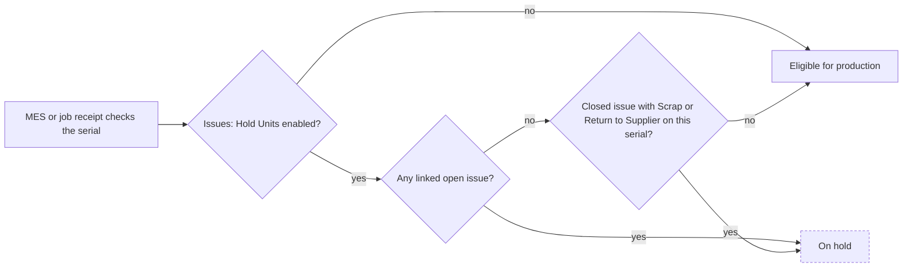

# Quality hold on a serial unit

> Status: implemented
> Date: 2026-11-23

## TLDR

A company can turn on **Issues: Hold Units** (Settings → Quality, off by
default). With it on, a serial unit is on hold on the shop floor while an issue
that is not Closed is linked to it. The MES refuses work that needs the unit
open and tells the operator which issue holds it. Other units of the job keep
moving. Closing the issue keeps serials marked Scrap or Return to Supplier blocked.

## Overview diagram

## Problem Statement

A quality issue raised on a serial unit recorded the problem and changed
nothing else: the unit's next operation could still be started and completed.
Shops that must stop a nonconforming unit relied on a tag and a person
checking. Holding the whole job is too coarse: the other units are good.

## Proposed Solution

**The rule.** A unit is on hold when `companySettings.holdUnitsWithOpenIssues`
is true and the `unitQualityHold` view finds an open issue linked to it, or
a closed issue whose material row dispositions that particular serial Scrap or
Return to Supplier. Closing an accepted issue clears its hold.

**Enforcement.** MES unit actions use `resolveWorkUnit` to check the selected
serial. Batch output, material consumption, rework dispatch and inventory
receipt also check the affected serials where they post their writes. An
explicit selection stays bound to that serial through posting.

| Write | A unit on hold |
|---|---|
| complete, scrap, rework or correction dispatch, step record, complete all steps, issue material, item scan, traveler claim | refused: "This unit is on hold for issue <number>" |
| kanban start and complete scans | skipped for the next open unit; refused when only units on hold are left |
| timer start | starts without naming the unit |
| quality issue, unconsume, part scrap (`member`) | allowed |

A failed read of the holds refuses the write.

**The screens.** The operation and assembly loaders read the same holds and
pass them to `useWorkUnit` as `isOnHold`. A unit on hold is not open, so the
existing `writesBlocked` disables its work, the first operation flows past it
and a later operation asks for another unit. A picked unit that goes on hold
stays on screen with a banner listing its open issues. The picker lists units
on hold after the open ones, with the issue number, and still opens when only
units on hold are left.

**Receipt to stock.** Finishing the last operation by hand, the ERP Complete dialog and a batch completion all end in
`complete_job_to_inventory`, which chose the units to receive by status and
serial number alone. A unit on hold could be received in place of a finished
one. With the setting on, the function leaves a unit on hold out of the units
it receives, and the completion quantity stops short of the units on hold. A
later completion can receive the unit if Quality accepts it. The Complete
dialog leaves those units out of its preview. If eligibility changes which
serials would be posted, Submit asks the operator to review the new selection.
Inspection counts only eligible passed serials and can complete a previously
held passed serial after release, even after the lot closes.

## Data

One column: `companySettings.holdUnitsWithOpenIssues BOOLEAN NOT NULL DEFAULT
false`. No new table. `complete_job_to_inventory` is redefined with the rule
in `20261124065150_close_quality_hold_write_paths.sql`. The setting controls
serial holds. Separately, closing a job WIP issue as Scrap or Return to
Supplier only deducts finished stock when the unit entered inventory.

## Not in scope

- A production override. Quality owns the disposition.
- Batch step records. Serial rework and correction dispatch check all blocking issues in the posting transaction.
- Partial lot holds. A lot is one tracked entity and uses the same link table, so the
  same rule would hold the whole lot. A partial defect would first be split
  into its own lot (`subdivideBatchEntity`), and only that lot held.
- Live refresh when the issue closes. The screen shows it on its next load.

## Tests

- `apps/mes/app/services/work-unit.test.ts`: each mode with a unit on hold,
  the setting off, a closed issue, a failed read.
- `apps/mes/app/services/unit-hold.server.test.ts`: the reader.
- `apps/mes/app/utils/workUnit.test.ts`: the screen rule.
- `apps/erp/test/database/job-receipt-unit-hold.test.ts`: a job of four with
  one unit on hold receives the other three; a completion of all four stops at
  three and receives the fourth once its issue is closed; a job whose only
  unit is on hold is refused; with the setting off the receipt is unchanged.
