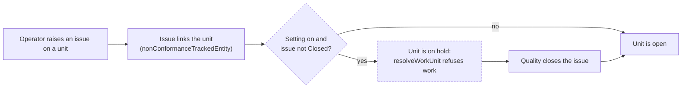

# Quality hold on a serial unit

> Status: implemented
> Date: 2026-11-23

## TLDR

A company can turn on **Issues: Hold Units** (Settings → Quality, off by
default). With it on, a serial unit is on hold on the shop floor while an issue
that is not Closed is linked to it. The MES refuses work that needs the unit
open and tells the operator which issue holds it. Other units of the job keep
moving. Closing the issue releases the unit.

## Overview diagram

## Problem Statement

A quality issue raised on a serial unit recorded the problem and changed
nothing else: the unit's next operation could still be started and completed.
Shops that must stop a nonconforming unit relied on a tag and a person
checking. Holding the whole job is too coarse: the other units are good.

## Proposed Solution

**The rule.** A unit is on hold when `companySettings.holdUnitsWithOpenIssues`
is true and a `nonConformanceTrackedEntity` row links it to an issue whose
status is not `Closed`. The hold is derived on every read. No status is stored,
so there is nothing to keep in step: closing or deleting the issue releases the
unit, and reopening it holds the unit again.

**One server check.** Every MES write of a serial unit already goes through
`resolveWorkUnit` (`apps/mes/app/services/work-unit.server.ts`; the
`mes-unit-write-resolves-unit` check fails a writer that skips it). It now
reads the holds of the units still to do (`readUnitHolds`) and treats a unit on
hold as not open:

| Write | A unit on hold |
|---|---|
| complete, scrap, rework, step record, complete all steps, issue material, item scan, traveler claim | refused: "This unit is on hold for issue <number>" |
| kanban start and complete scans | skipped for the next open unit; refused when only units on hold are left |
| timer start | starts without naming the unit |
| quality issue, correction, unconsume, part scrap (`member`) | allowed |

A failed read of the holds refuses the write.

**The screens.** The operation and assembly loaders read the same holds and
pass them to `useWorkUnit` as `isOnHold`. A unit on hold is not open, so the
existing `writesBlocked` disables its work, the first operation flows past it
and a later operation asks for another unit. A picked unit that goes on hold
stays on screen with a banner listing its open issues. The picker lists units
on hold after the open ones, with the issue number, and still opens when only
units on hold are left.

**Receipt to stock.** A completion names no unit: finishing the last operation
by hand, the ERP's Complete and a batch completion all end in
`complete_job_to_inventory`, which chose the units to receive by status and
serial number alone. A unit on hold could be received in place of a finished
one. With the setting on, the function leaves a unit on hold out of the units
it receives, and the completion quantity stops short of the units on hold. A
later completion receives the unit once its issue is closed. The Complete
dialog leaves those units out of its preview. An inspection lot's decision
leaves them out of the units it completes.

## Data

One column: `companySettings.holdUnitsWithOpenIssues BOOLEAN NOT NULL DEFAULT
false`. No new table. `complete_job_to_inventory` is redefined with the rule
(`20261124035931_unit-hold-job-receipt.sql`); with the setting off it behaves as
before.

## Not in scope

- An override. Closing the issue is the release.
- `trigger-rework` and batch step records, which do not use
  `resolveWorkUnit` and complete no unit.
- What the unit does after its issue closes. A Scrap or Return to Supplier
  disposition sets the unit `Rejected`, and the MES does not stop work on a
  `Rejected` unit. That is unchanged.
- Batches. A lot is one tracked entity and uses the same link table, so the
  same rule would hold the whole lot. A partial defect would first be split
  into its own lot (`subdivideBatchEntity`), and only that lot held.
- Live refresh when the issue closes. The screen shows it on its next load.

## Tests

- `apps/mes/app/services/work-unit.test.ts`: each mode with a unit on hold,
  the setting off, a closed issue, a failed read.
- `apps/mes/app/services/unit-hold.server.test.ts`: the reader.
- `apps/mes/app/utils/workUnit.test.ts`: the screen rule.
- `apps/erp/test/database/job-receipt-unit-hold.test.ts`: a job of four with
  one unit on hold receives the other three; a completion of all four stops at
  three and receives the fourth once its issue is closed; a job whose only
  unit is on hold is refused; with the setting off the receipt is unchanged.
